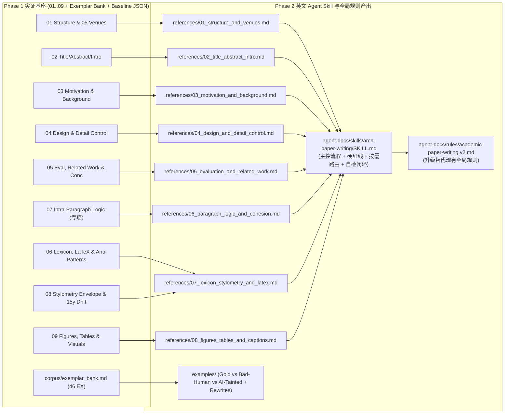

# 计算机体系结构顶会论文写作实证研究 — Phase 1 总览与核验综合报告（ISCA / MICRO / HPCA / ASPLOS, 2011–2026）

> **文档定位**：本报告为 Phase 1（15 年大规模实证调研阶段）的**独立审计报告与最高层综合摘要**，面向 **Phase 1 Review Gate** 决策审阅，完整汇总并交叉核验了全部 9 份专项分析报告（[`01`–`09`](01_structure_and_story_arc.md)）、逐字正反例原文库（`exemplar_bank.md`）、全量计量文体学基线（`human_stylometry_baseline.json`）与 20 篇公开 OA 论文的像素级视觉资产（`rendered_figures/index.json`），并给出向 **Phase 2 英文 Agent Skill** 与 **Phase 3 隔离盲测验证**转化的精确工程蓝图。

---

## 1. 语料构建、严格隔离与独立核验总览

### 1.1 分层实证语料架构（160 篇，跨 4 大顶会 × 16 年）

全部研究严格以 `manifest.json` 为唯一数据清单，160 篇论文 100% 经 `pdftotext` 干净提取并通过质量校验（`extraction_status == "ok"`），划分为四个严密分层的子集：

| 语料分层 | 篇数 | 时代与顶会覆盖 | 核心用途与隔离纪律 |
| :--- | :---: | :--- | :--- |
| **`macro_pool`（宏观全量池）** | **152** | ISCA / MICRO / HPCA / ASPLOS 各 **38 篇**；覆盖 `2011–2026` 全部 64 个 `(会议, 年份)` 单元格（`2011–15`: 47、`2016–22`: 65、`2023–26`: 40） | Python 计量文体学、结构/章节预算、15 年历时演进与开放词表 AI 漂移扫描 |
| **`deep_read`（深度精读子集）** | **48** | `macro_pool` 的子集，每会 12 篇：包含 **`pure_human_exemplar` (2011–2022 标杆, n=22)**、**`post2023_exemplar` (2023–2026 标杆, n=10)**、**`contrast_ordinary` (2015–2022 普通人类, n=10)**、**`contrast_post2023` (2024–2026 AI 痕迹对照, n=6)** | 11 维逐页精读、45 段句间微逻辑手工编码、671 图注/164 表注解剖与 46 条逐字原文库构建 |
| **`visual_oa`（公开 OA 视觉集）** | **20** | `deep_read` 的子集（14 `exemplar` + 3 `contrast_ordinary` + 3 `contrast_post2023`，2012–2026）；100% 经 `HTTP 200 application/pdf` 验证并渲染为 **118 张 150 DPI PNG** | 人工像素级精审 **92 张核心图文页**（色彩、字号、碰撞、框图语法、表格工艺、图内错词） |
| **`held_out_test`（盲测隔离池）** | **8** | 仅选 `2016–2022` 纯人类获奖/顶组标杆（ISCA / MICRO / HPCA / ASPLOS 各 2 篇） | **物理级零接触隔离**，仅保留至 Phase 3 双盲图灵测试；`macro_cache/` 与 `rendered_figures/` 均零入库 |

### 1.2 独立程序化审计结果（Phase 1 Auditor Verification）

由独立审计员 `verifier-phase1` 对全部 Phase 1 产出执行四项自动化与交叉核验，结果如下：**零泄漏、零断链、零越界、零事实矛盾**。

| 审计项目 | 检验范围与方法 | 独立核验结果 | 判定 |
| :--- | :--- | :--- | :---: |
| **1. 零泄漏审计（Zero-Leakage）** | 扫描全部 9 份 `analysis/01..09_*.md`、`exemplar_bank.md` 与 `human_stylometry_baseline.json`（共 11 个文件），检索 8 篇 `held_out_test` 的 `paper_id`、完整标题与特征系统名；核查 `macro_cache/`（152 文件）与 `rendered_figures/`（20 目录） | 文本/JSON 命中 **0 / 11 文件**；缓存目录交集 **0**；视觉目录交集 **0** | **PASS (0 泄漏)** |
| **2. 文件链接审计（100% `file://` Links）** | 提取全部 10 份 Markdown 中每一条 `file://` 链接并检验磁盘存在性 | 共核验 **273 / 273 条（100%）** 链接存在（其中 [09](09_figures_tables_and_visuals.md) **269/269**、[08](08_stylometry_and_evolution.md) **3/3**、[06](06_lexicon_style_and_antipatterns.md) **1/1**），缺失 **0** | **PASS (100%)** |
| **3. 引文、页码与逐字原句抽检** | ① 全量校验 10 份文档中 `374` 处 `(paper_id, p. X)` 页码边界；② 全量核验 `exemplar_bank.md` 全部 46 条逐字摘录；③ 跨 `01..09` 抽检 42 条典型英文原句对照 `corpus/macro_cache/<paper_id>.json` 精确页码 | ① 页码越界 **0 / 374**；② 原文库精确页匹配 **46 / 46（100%）**；③ 跨 9 份报告精选抽检精确页匹配 **42 / 42（100%）**（合计 **88 / 88** 精确核实；另自动批量命中 150+ 处行内引文）；[06](06_lexicon_style_and_antipatterns.md) 中 3 个非 `macro_pool` ID 已确认合法引自 `staging/post2023_ai_marker_hits.json` 作假阳性警示（零 `held_out`） | **PASS (100%)** |
| **4. 跨报告一致性与维度完备性** | 逐项核对 `human_stylometry_baseline.json` 与 9 份报告重叠统计指标，审查 11 个研究维度覆盖度 | **0 处实质性矛盾**；所有分母/口径差异均完成精确对账（见表 1-1）；全部 11 维深度覆盖无盲区（注：[08](08_stylometry_and_evolution.md) 标题写作“维度 8 与维度 9”系其内部编号，对应全局维度 8 计量文体学 + 维度 11 十五年演进） | **PASS (全覆盖)** |

### 1.3 跨报告统计口径透明对账表（Denominator Reconciliation）

因各专项报告采用不同分析粒度（全文原始词 vs 纯散文清洗词、全语料 vs 含该章节子集、每百句 vs 每万词），下表将读者可能注意到的口径差异一次性对齐，确保 Phase 2 引用绝对精确：

| 重叠指标 | 各报告报告值与出处 | 差异成因与统一口径结论 |
| :--- | :--- | :--- |
| **正文词数 (`body_word_count`)** | [01](01_structure_and_story_arc.md) 中位 `9,934w` ｜ [03](03_motivation_and_background.md) 均值 `11,103w` ｜ [08](08_stylometry_and_evolution.md) 均值 `7,585w` / 中位 `7,556w` | [03] 含 Title/Abstract/图表原始全文（Ref 前）；[01] 为 Sec 1–Conclusion 原始 PDF 词（含图表注释）；[08] 剥离了标题摘要、图表、框图文字与页眉，仅计**纯散文正文词**。三者完全一致，Phase 2 预算同时保留**版面总字数 ~9.5–10.5K** 与**纯散文 ~7.1–8.6K**。 |
| **摘要词数与年代趋势** | [02](02_title_abstract_intro.md)（N=148）中位 `212w`，年代 `214→200→228w` ｜ [08](08_stylometry_and_evolution.md)（N=150）中位 `215.5w`，均值 `249→233→205w` | 总体中位数高度一致（**~212–216 词**，IQR **175–257 词**）。[08] 中 `2011–15` 均值偏高（`p90=383w`）源于少数早期双栏 PDF 摘要边界轻微溢入右栏引言；年代趋势应以 [02] 严格边界清洗口径（稳定在 200–228 词）为准。 |
| **Related Work 后置比例** | [01](01_structure_and_story_arc.md) `76.7%`（N=150）｜ [08](08_stylometry_and_evolution.md) `76.3%`（N=152，PHE `81.8%`）｜ [05](05_evaluation_and_related_work.md) `88.1%`（N=126，`exemplar` `96.3%`） | [01]/[08] 以**全语料**为分母（含 ~11%–17% 无独立 RW 节的论文）；[05] 以**设有独立 RW 节的 126 篇**为条件分母（111/126 = 88.1%，2023–26 升至 93.3%）。 |
| **`Limitations` / `Artifact` 占比** | [01](01_structure_and_story_arc.md) `2023–26`: Lim `17.5%` / Art `17.5%` ｜ [08](08_stylometry_and_evolution.md) `2023–26`: Lim `37.5%` / Art `30.0%` | [01]/[05] 仅计**独立顶级/显式小节标题**；[08] 兼计**子节与行内加粗段声明**（如 `Limitations.` / `Artifact Availability.`）。两者 2026 年 Artifact Appendix 均精确收敛于 **38%**。 |
| **破折号（Em-Dash）密度** | [08](08_stylometry_and_evolution.md) PHE `0.95/1k` vs Post23 `0.23/1k`（**4.1×**）｜ [06](06_lexicon_style_and_antipatterns.md) pre23 `8.66/10k` vs Post23 `2.19/10k`（**4.0×**） | 仅单位不同（每千纯散文词 vs 每万原始词），两者独立收敛于**纯人类标杆为 AI 对照组 ~4.0 倍**。 |
| **被动语态密度** | [08](08_stylometry_and_evolution.md) 按句计：Ord `27.1%` > PHE `20.2%` > Post23 `16.6%` ｜ [06](06_lexicon_style_and_antipatterns.md) 按构造/万词计：Ord `124.0` > pre23 `88.6` > Post23 `61.5` | 单位不同（含被动句占比 vs 被动结构次/万词），双向分裂格局完全一致。 |
| **Given-New 衔接与连接词** | [08](08_stylometry_and_evolution.md) 前 5 词直链 `39.9%→31.3%`、窄过渡副词 `4.32→7.95/100s` ｜ [07](07_paragraph_logic_and_cohesion.md) 尾→头宏代理 `38.4%→28.5%`、微观人工编码真 `GN` `82.6%→42.3%`、宽连接词 `8.52→11.55/100s` | 窗口与词表宽窄不同（[08] 统计全部洁净句与 ~12 个副词；[07] 统计 ≥4 句段落、宽连接词表并叠加 223 处人工语义编码），方向与量级高度互证。 |
| **AI 词表密度** | [08](08_stylometry_and_evolution.md) 28 词表 `11.77→65.89/10k`（5.6×）｜ [03](03_motivation_and_background.md) 14 营销词 `0.61→8.71/10k`（14.3×）｜ [05](05_evaluation_and_related_work.md) 篇均浮夸词 `1.66→12.33` | 词表范围递窄（含过渡词的 28 词表 → 纯营销 14 词 → 篇均计次），共同指向 2023/2024 断崖跃升。 |

---

## 2. 六大颠覆直觉的实证核心发现

横跨 9 份专项报告的定量与逐句精读证据，汇流成六条直接颠覆流行写作认知的核心实证规律：

### 发现一：AI 段落散架的底层病理——「同义词轮换 → 衔接断裂 → 过渡词打补丁」三联症
- **宏观机制（[08](08_stylometry_and_evolution.md)）**：全池 152 篇 Spearman 相关表明，局部词汇表面多样性 `MATTR-100` 与相邻句实词重叠 Jaccard 呈**极强负相关（$\rho = -0.792, p < 10^{-6}$）**，与 Given-New 前 5 词承接率呈强负相关（$\rho = -0.474, p < 10^{-6}$），而与 AI 词表密度正相关（$\rho = +0.459, p < 10^{-6}$）。LLM 出于“避免重复”的微调惯性，把锁定的硬件术语反复轮换为 `approach / method / paradigm / strategy / mechanism`，把 `MATTR-100` 从纯人类的 **`0.681`** 拉升到 **`0.728`**（$p=0.0023$），直接扯断了术语链（相邻实词继承率 `17.7% → 13.0%`, $p<10^{-4}$；Given-New5 `39.9% → 31.3%`, $p=0.014$）。
- **微观拓扑崩塌（[07](07_paragraph_logic_and_cohesion.md)）**：在 45 段 223 处邻句转移的手工编码中，纯人类标杆（2011–2022）的线性旧→新链（`GN`）高达 **`82.6%`**、断链/复读（`PP`）为 **`0.0%`**，**乱序测试（Shuffle Test）与去连接词测试双双 100%（20/20）通过**；而 `contrast_post2023` 真 `GN` 暴跌至 **`42.3%`**、`PP` 飙升至 **`42.3%`**，超过半数段落乱序后居然依然读得通（通过率 `45.5%`），近 2/3 靠假胶水硬撑（去连接词通过率 `36.4%`）。
- **胶水爆炸 vs 具象因果萎缩（[06](06_lexicon_style_and_antipatterns.md), [07](07_paragraph_logic_and_cohesion.md), [08](08_stylometry_and_evolution.md)）**：为了遮掩星型同义复读（`D1` 检出率 72.7%），AI 污染文狂贴 `Additionally,`（**10×–14.5×**）与 `Notably,`（**10.8×–11.5×**），同时纯人类赖以成立的显性因果与具象例证断崖暴跌：**`because` 跌 3.3×（`10.98 → 3.29/10k`）、`For example,` 跌 6.1×（`8.57 → 1.41/千句`）**，全池 721 个纯人类标杆段落中同段双叠 `Moreover/Furthermore/Additionally` 的比例严格为 **`0.00%`**！

### 发现二：A 类人类坏写法 vs B 类 AI 污染的「双轴反向分裂」与「双峰指代病理」
- **语态轴反向分裂（[06](06_lexicon_style_and_antipatterns.md), [08](08_stylometry_and_evolution.md)）**：普通人类差文（Class A）最典型的毛病是“死板被动语态说明书墙”（`27.1%/100s` / `123.95/10k`，比纯人类标杆高 40%）；而 AI 污染文（Class B）的被动语态反而跌至**全场最低（`16.6%/100s` / `61.52/10k`）**！LLM 用看似流畅的主动语态掩盖语义空心化：具体微架构动词全面枯萎（`track` 降 **25.6×**、`incur` 降 3×、`dominate` 降 4×、`amortize` 归零），取而代之的是空心包装动词（`enhance` **22.6×**、`facilitate` **22.0×**、`underscore` **27.5×**）与分词尾挂（`, ensuring` **15.7×**、`, enabling` **7.0×**）。**因此，单纯压低被动语态绝不能产出好论文，反而可能把文本推向伪流畅 AI 腔。**
- **双峰指代病理（[07](07_paragraph_logic_and_cohesion.md)）**：两类差文都会指代失焦，但语法形态截然不同——Class A 人类差文表现为**裸代词悬空**（`This is / It avoids` 达 `3.01%` vs 标杆 `1.82%`），而 Class B AI 文本学会了规避裸 `This`，却演化出更隐蔽的**空壳名词指代**（`This approach / These merits / These challenges / This strategy` 达 **`2.08%`**，为纯人类标杆 `0.38%` 的 **5.5 倍**，占全部指示词短语近 1/3！）。此外，后 2023 论文独有**缝合断层（Frankenstein Seam）**：作者仅把首段/导语交由 LLM 润色，手写技术细节未校对，导致满级 GPT 紫文与非母语病句同页零距离撞车（`QPlacer` p.1–2、`Hestia` p.5）。

### 发现三：彻底证伪「破折号 = AI」与「IEEE `Figure`/`Fig.` 分裂」两大流行迷思
- **破折号迷思证伪（[06](06_lexicon_style_and_antipatterns.md), [08](08_stylometry_and_evolution.md)）**：两套独立脚本（[08] `N=152` 与 [06] `N=48` 剔除 `Abstract—` 后）得出惊人一致的结果——纯人类标杆的正文长破折号（`—`）使用密度（`0.95/1k` / `8.66/10k`）是 AI 污染对照组（`0.23/1k` / `2.19/10k`）的 **4.0–4.1 倍**！资深母语架构师（`Clearing the Clouds`, `RowHammer`, `Swarm`, `Pond`, `HFI`）高频善用 `---` 作紧凑插入定义与机制补注。真正需拦截的是超 P90 阈值（**`> 2.5/1k`**）的滥用，或把 `---` 误用于数值范围（应用 en-dash `--`）。
- **交叉引用实测真相（[06](06_lexicon_style_and_antipatterns.md)）**：教科书常宣称 IEEE 论文须“句首写 `Figure`、句中写 `Fig.`”，但对 48 篇顶会精读论文的逐句审计显示，严格遵循该分裂规则的论文为 **`0 / 48` 篇**！实战规范是 **89.6%（43/48）全篇锁死单一形式**（推荐 `Figure` + `Section`，ASPLOS 可配 `§`，HPCA 严禁 `§` [0/38]），且 **`Table` 永远全拼**（1,216 vs 5），`e.g.,`/`i.e.,` 强制美式逗号（2023–26 达 **96.6% / 99.3%**）。

### 发现四：黄金前两页范式剧变——传统导读段彻底消亡（`43.2% → 0%`），正文篇幅 15 年守恒
- **导读段消亡曲线（[02](02_title_abstract_intro.md)）**：引言末尾的 `"The rest of this paper is organized as follows. Section 2 describes..."` 从 `2011–15` 的 **`43.2%`** 断崖跌至 `2016–22` 的 `19.7%`、`2023–26` 的 `7.5%`，并在 **2025 年（0/12）与 2026 年（0/8）彻底归零（0%）**！现代顶会一律用贡献列表末尾的 `(§X)` 内嵌锚点替代。
- **前两页硬边界与首图前移（[01](01_structure_and_story_arc.md), [02](02_title_abstract_intro.md), [09](09_figures_tables_and_visuals.md)）**：**82.8%** 论文在 Page 2 结束前完成 Intro（中位 `p.1.74`）；**65.5%–68.8%** 在前两页亮出 Figure 1，且 **Page 1 首图比例翻倍（`11.4% → 27.5%`）**；贡献清单升至 **80.0%**（3–4 条占 72.9%）。与此同时，尽管 PDF 总页数因参考文献不计页限（`0.9p → 2.5p`）与 Artifact Appendix（`0% → 38%` in 2026）从 `12.5p` 增至 `15.3p`，但**纯散文正文词数 15 年纹丝不动（`7,501 → 7,683 → 7,525` 词, $p=0.43$）**，完美守恒于 **“40-25-20-15”黄金版面律**（设计 ~40%、评估 ~25%、引言+背景动机 ~20%、收尾 ~10%）。

### 发现五：详略程度失控的两极病灶——「RTL 数据手册倾倒」vs「后 2023 形式化通胀与虚假精度」
- **传统 Class A 病灶——RTL 散文倾倒（[04](04_design_and_detail_control.md), [08](08_stylometry_and_evolution.md)）**：普通人类论文在正文中塞入多出 **+35%** 的位宽词（`11.6 vs 8.6/10k`）与 **+60%** 的 RTL 器件词（`7.7 vs 4.8/10k`，如 `TimeCache` 科普 `'1100' > '0101'` 与 2 个 SR 锁存器引脚接线），却仅用 `2.40` 张表（标杆 `4.05` 张, $p=0.026$），不会用表格封装低层参数。
- **现代 Class B 病灶——形式化与虚假精度通胀（[04](04_design_and_detail_control.md), [05](05_evaluation_and_related_work.md)）**：**87.5%** 的顶会 `exemplar` 全篇使用 **0 个 `Algorithm` 伪代码块**（仅 `12.5%` 使用，篇均 `0.19`），但 `contrast_post2023` 暴涨 **4×** 至 **`50.0%`**；全池编号公式 15 年暴涨 **3.6×**（`1.23 → 4.45` 篇均，`contrast_post2023` 达 `4.83`），大量把朴素工程启发式包装成伪组合优化（`FastTTS`）或引入废弃集合符号（`iThreads`、`QPlacer`）。评估数字同步恶化：`contrast_post2023` 两位小数百分比暴涨 **4.3×**（**`33.9%`** vs `exemplar` `7.8%`），负面/异常诚实披露密度却暴跌 **2.4×**（`0.72` vs `1.72/1k`）。

### 发现六：精确锁定 2024 年 AI 断崖拐点，开放词表捕获隐性膨胀词与“濒危人类朴素词”
- **逐年断崖曲线（[08](08_stylometry_and_evolution.md)）**：2011–2023 整整 13 年（2023 顶会多截稿于 GPT-4 发布前），AI 词表密度稳定在 **`11.8–14.2 / 10k`**、MATTR 稳定在 `0.67–0.68`；**2024 年**陡升至 **`27.2`**，**2025–2026 年**跃居 **`40.5 / 39.2`**，2026 年 MATTR 升至 `0.746`、Given-New5 跌至 `0.283`、句长突发性 SD 压扁至 `9.19`！其中 `pivotal`、`nuanced`、`paramount`、`foster`、`play a crucial/pivotal role` 在 2011–2022 全部 **112 篇纯人类论文中出现次数严格为 0**。
- **开放词表 3,702 词新发现（[08](08_stylometry_and_evolution.md)）**：剥离主题漂移（`llms`, `ablation`, `adaptive`）后，实证捕获一批传统黑名单之外的隐性 AI 膨胀词（均 BH-FDR $q < 0.03$）——**`diverse`（10.2×，全词表第 1！）、`enhance/enhances/enhancing`（5.6–7.8×）、`subsequently`（7.1×）、`confirming`（6.3×）、`consistently`（5.0×）、`conversely`（5.0×）、`mitigates`（4.6×）、`solely`（4.5×）、`inherently`（4.4×）、`essential`（4.3×）、`substantial`（3.6×）、`, allowing`（2.6×）**；与此同时，纯人类最自然的朴素好词正成批消失：**`roughly`（-69%）、`gives`（-63%）、`describe`（-59%）、`possible`（-53%）、`assume`（-52%）、`note`（-46%，被 `Notably,` 替代）**。相反，**`moreover` 并未在 2023+ 飙升（0.77×, $p=0.37$）**，且 ARM CCA 官方术语 `Realm` 与 `PVCoherence` 的 `"do not delve"` 证明检测器必须采用**多信号共现 + 搭配上下文**防误杀。

---

## 3. 三元区分总表：标杆纯人类（2011–2022）vs A 类人类坏写法 vs B 类 AI 腔 / 2023+ 污染

> 本表统一整合 `01..09` 全部对账后实证指标，清晰划出 **Bucket 1（唯一正面学习基准）** 与 **Bucket 2（Class A 人类病灶）**、**Bucket 3（Class B AI 污染红线）** 的定量边界。

| 写作维度 | **标杆纯人类（2011–2022 PHE, n=22 / exemplar）** `[GOLD-HUMAN]` 正面锚点 | **A 类：普通人类坏写法（`contrast_ordinary`, n=10）** `[BAD-HUMAN]` 人类通病 | **B 类：后 2023 AI 腔 / 污染文（`contrast_post2023`, n=6）** `[AI-TAINTED]` 红线拦截对象 |
| :--- | :--- | :--- | :--- |
| **宏观结构与预算**（[01](01_structure_and_story_arc.md)） | Design 占比 **42.0%**（5.17p），Bg+Mot 紧凑 **10.1%**（1.65p）；仅 **12.9%** 机械拆 `Bg+Mot`，多用命题标题；显式 `Limitations` **16.1%** | Bg+Mot 偏长 **16.9%**（1.97p，多为教材科普）；显式 `Limitations` **0%**；行内小标题段仅 **4.0%**（标杆 **11.4%**, $p=0.017$） | 总页最厚（15.0p, Ref 3.0p）但正文字数最少；**83.3%** 机械二分 `2. Bg + 3. Mot`（占 17.9%）；显式 `Limitations` **0%**；误把设计节叫 `Methodology` |
| **标题与摘要**（[02](02_title_abstract_intro.md), [06](06_lexicon_style_and_antipatterns.md)） | 6–10 词；**21.9%** 意象/动作冒号体、**25%** 不造炫酷系统名、**0%** Forced Backronym；摘要 160–240 词、1–2 个核心数、物理事实首句 | 长句平铺无锚点；零数字或 6+ 数字堆砌摘要；摘要原封不动复制进引言（`Authenticache`, `TimeCache`） | **100%** 冒号体 + 高连字符修饰链（`1.17`）；**100%** 的 Forced Backronym（`PICACHU`, `M-ANT`）集中于此；`"In the past decade / Recent advances..."` 宏大首句 |
| **背景与动机**（[03](03_motivation_and_background.md)） | 极简即时背景（300–900w）；Oracle/Headroom + 生产遥测 + 预判审稿人 #1 质疑；`"However, existing..."` 仅 **0.06/篇**；逻辑桥无剧透交接 | 1,700–2,000w 教科书科普（`AVA`, `PREMA`），零实证动机图，凭主观 `"it is unnatural"` 拍脑袋 | 2025 年仍抄 Attention 教材公式；`"However, existing..."` **8.3×**（0.50）；营销词 **14.3×**（8.71/10k）；对称 `Challenge-1/2/3` + 动机段复制引言或剧透结果 |
| **设计与详略控制**（[04](04_design_and_detail_control.md)） | 六层抽象阶梯 + 挣来的细节（Earned-Detail）+ 双轨走查；表格封装参数（**4.05** 表）；**87.5%** 零 `Algorithm` 框，公式均值 **1.97** | **RTL 说明书倾倒**：位宽词 **+35%**（11.6 vs 8.6）、RTL 器件词 **+60%**（7.7 vs 4.8），汇总表仅 **2.40** 张（$p=0.026$）；逐门接线叙事 | **形式化通胀**：`Algorithm` 框 **50.0%（4×）**，编号公式 **4.83（2.5×）**；把朴素启发式包成假组合优化 + 逐行复读伪代码 |
| **评估、RW 与结论**（[05](05_evaluation_and_related_work.md)） | Meth 精炼（768w）+ 调优竞品；负面/诚实披露 **1.72/1k**；**92.0%** 百分比 ≤1 位小数；RW **96.3%** 后置且按设计轴分类；Abs–Conc 3-gram 重合 **9.51%** | 机械按字母序念柱子（`AVA`）；正文/表/图三重复写（`TimeCache`）；缺 head-to-head 基线；对抗性一刀切否定前人；伪精度（`0.43099 pJ`） | 诚实披露暴跌至 **0.72/1k（-2.4×）**，输柱硬夸 `consistently superior`；2 位小数占比 **33.9%（4.3×）**；RW 句首作者流水账 **1.8×**；Abs–Conc 重合 **18.07%**（峰值 44.1%）+ 口号尾句 |
| **段内逻辑与指代**（[07](07_paragraph_logic_and_cohesion.md)） | 微观 `GN` 链 **82.6%**、`PP` **0.0%**；Shuffle & Connector-Del **100% PASS**；六大病灶 **0/20**；裸指代 **1.82%**、空壳名词 **0.38%**；`For example,` `8.57/1k` | `GN` **46.6%**、`PP` **32.8%**；Shuffle `50%`；病灶 `8/10`（1.70/段，主打 `D2` 伪连接 + `D5` 平行罗列）；**裸指代飙升至 `3.01%`**（`It` 跨 5 句悬空） | `GN` **42.3%**、`PP` **42.3%**；Shuffle **`45.5%`**、Connector-Del **`36.4%`**；病灶 **11/11（2.64/段，`D1` 复读 72.7%、`D3` 因果跳步/幻觉 45.5%）**；**空壳名词指代 `2.08%（5.5×）`**；`For example,` 崩塌 **-6.1×** |
| **句式节奏与计量**（[07](07_paragraph_logic_and_cohesion.md), [08](08_stylometry_and_evolution.md)） | 句长 `19.8w`，突发性 **SD `10.68`**、邻句差 **`10.98`**；短句 `≤12w` 占 **26.8%**；逻辑角色耦合节奏（Pivot 中位 `12.5w` vs 机制 `22.5w`，微 `CV 0.411`）；`MATTR` **`0.681`**；AI 词表 **`11.77/10k`** | 句长 SD `10.67`（保持人类起伏），`MATTR` `0.669`，AI 词表 `15.93/10k`；但常伴 55–77 词缠绕病句 | **21 词传送带扁平效应**：宏观 `S1→Mid→Sk` 仅 `21.1→21.5→21.9`，微 `CV` 压扁至 **`0.278`**（短锤段仅 `36.4%` vs `80.0%`）；`MATTR` 膨胀至 **`0.728`**；AI 词表暴涨 **5.6×** 至 **`65.89/10k`** |
| **用词、语态与标点**（[06](06_lexicon_style_and_antipatterns.md), [08](08_stylometry_and_evolution.md)） | 被动适中（`20.2%/100s` / `88.6/10k`）；本位强动词（`stall/squash/track/incur/amortize`）；显性 `because`（10.98）+ `unfortunately` + `conservatively`；长破折号 **`0.95/1k`**（`8.66/10k`） | **超高被动墙**（`27.1%/100s` / `124.0/10k`）；非母语直译（`cannot but`, `responsible of`, `need not have to`）；缩写字母汤撞车；防御性补丁 | **超低被动伪流畅**（`16.6%/100s` / `61.5/10k`）；包装动词（`enhance 22.6×`, `facilitate 22.0×`）；`because` 跌 3.3×，`, ensuring 15.7×`, `Additionally, 10–14.5×`；冒号涨 55%（128/10k）；破折号最低（`0.23/1k`）；**缝合断层** |
| **图表与视觉工艺**（[09](09_figures_tables_and_visuals.md)） | 14.5 图 + 3.0 表；低饱和双冗余配色 + 曲线直标 + 阴影 `GEOMEAN` + 实虚线路径分离 + booktabs 零竖线；图注中位 **18w**（结论率 **13.2%**） | 24 宫格图墙（`AVA`）或 26 图 42 柱微缩条形码（`Turnpike`）；亮黄柱 + 网格笼表；哑巴图注中位 **12w**（结论率 **6.5%**） | 图表工具现代但涌现新公害：16 色彩虹堆叠柱（`M-ANT`）、糖果斑马表 + 缺失双轴单位（`ρHammer`）、`128256512` 刻度碰撞 + 未解释绿柱 + 冗余 1D 色条（`FastTTS`） |

---

## 4. 「顶会/获奖论文也不能盲目模仿」批判警示录

本次研究坚持最核心的学术纪律——**绝不神化顶会录用论文，哪怕是 Best Paper / IEEE Micro Top Picks**。跨 9 份报告的逐页核验，实锤抓出两类必须在 Phase 2 规则中显式拉黑的获奖论文瑕疵：

### 4.1 警惕 2024–2026 获奖论文中的「AI 润色渗漏（Award-Paper AI-Drift）」

计量统计显示，即便是 `post2023_exemplar`（n=10）的 AI 词表密度也翻倍至 **`22.70 / 10k`**（纯人类标杆仅 `11.77 / 10k`）。这些论文凭借硬核架构思路夺奖，但其英文润色已明显渗入 LLM 杂质——**绝不可将其开篇、过渡段或结论当作风格范本！**

| 获奖论文 | 荣誉与核验出处 | 已实锤的 AI 漂移与校对事故（切忌模仿） |
| :--- | :--- | :--- |
| **`PF-LLM`** | ASPLOS 2026 Best Paper (`conf__asplos__XuSLBWLX026`, [01](01_structure_and_story_arc.md), [03](03_motivation_and_background.md), [05](05_evaluation_and_related_work.md), [06](06_lexicon_style_and_antipatterns.md), [08](08_stylometry_and_evolution.md)) | ① 全文 AI 词表高达 **`56.3 / 10k`**（`MATTR=0.736`, `GN5=0.274`）；② **p. 12 误贴事故**：将一整段 131 词纯 GPT 章节总导语（`"we delve into the rationale ... within the broader landscape"`）直接误贴进 `7.1` 小节开头（`EX-33`）；③ **零实证 §3 动机节 + 提前剧透评估数字**（p. 4 直接贴出 `95%` / `18.9%`）；④ 摘要过度宣称 `"oracle-level ... always"`（p. 1）+ 结论 `"This work pioneers..."`；⑤ 机械失校：p. 2 未解析引文 `[2, 18, 21, 35? ]`、p. 10 `"three of the mostly widely-used"` 却列 4 项、`"LMHint Prefetcher prefetcher"`。 |
| **`DynamoLLM`** | HPCA 2025 Best Paper (`conf__hpca__StojkovicZGTC25`, [02](02_title_abstract_intro.md), [03](03_motivation_and_background.md), [06](06_lexicon_style_and_antipatterns.md), [07](07_paragraph_logic_and_cohesion.md)) | ① p. 1 密集命中 **10 处/7 类 AI 标记词**（`pivotal`, `paramount`, `underscores`, `To pave the way towards`, `seamlessly`, `holistic`）（`EX-11`）；② Intro 第 2 段（`P24`）出现三句车轱辘式同义复读（`D1`, `CV=0.280`），与其自身硬核的 Design/Eval 段形成强烈割裂；③ §3 动机中反复前向剧透 `"In DynamoLLM, we will..."`（p. 4–5）；④ 漏词/冠词笔误 `"and other."`（p. 1）与 `"an 40% error"`（p. 10）。 |
| **`LLM.265`** | MICRO 2025 Best Paper (`conf__micro__XuW0CLZW25`, [02](02_title_abstract_intro.md), [05](05_evaluation_and_related_work.md), [06](06_lexicon_style_and_antipatterns.md), [09](09_figures_tables_and_visuals.md)) | ① **183 词摘要零量化数字**且堆砌分词拖尾（`EX-04`）；② Intro 首句 AI 腔 `"showcasing remarkable proficiency in various applications..."` 并重复引用 `[60]`；③ p. 10 遗留 `<latexit>` XML 标签、p. 13 语法硬伤 `"are been verified"`；④ 矢量图内 5 处拼写错误（`"Armortize"`, `"Explot"`, `"Comparision"`, `"bid-width"`, `"pipline"`）且 Fig 5/6 红虚线缺图例。 |

### 4.2 纯人类获奖 / Top Picks 论文中的真实瑕疵（破除盲目崇拜）

即使在 2011–2024 纯人类经典名篇中，也普遍存在赶稿妥协或学派癖好，Phase 2 规则须**精准剥离其精华与糟粕**：

- **视觉与排版硬伤（[09](09_figures_tables_and_visuals.md)）**：
  - **`Pond`（ASPLOS'23 Distinguished）**：视觉整体堪称当代标杆，但 **p. 13 出现同页红蓝语义反转**（左 Fig 20 蓝=`222%`/红=`182%`，右 Fig 21 及全文均为红=`222%`/蓝=`182%`）！
  - **`SIGMA`（HPCA'20 Best Paper）**：获奖论文最全视觉反面标本——Fig 2 饼图、Fig 10–14 原生 Excel 双轴柱线混叠且用连续折线连离散矩阵、Fig 5 3.5pt 微缩字、`"Efficiecny"` 图内错词；文本同时存在 `P23` Rebuttal `Additionally,` 漂移、`2x/6×/3X` 混用、多处主谓一致错与 `"For e.g.,"`（[05](05_evaluation_and_related_work.md), [06](06_lexicon_style_and_antipatterns.md), [07](07_paragraph_logic_and_cohesion.md)）。
  - **`InvisiSpec`（MICRO'18）** Fig 4 `libquantum` 撞压图注；**`SALP`（ISCA'12）**/**`Eyeriss`（ISCA'16）**/**`Elastic Cuckoo`（ASPLOS'20）** 多子图重复 3–4 遍相同图例 + 无纹理近阶灰柱；**`FireSim`**（`"Figure VI"`）与 **`Constable`**（`"Fig. 14"` 误指 Fig 11）图文编号错位。
- **结构、详略与修辞硬伤（[01](01_structure_and_story_arc.md)–[06](06_lexicon_style_and_antipatterns.md)）**：
  - **`Whisper`（MICRO'22 Best Paper）**：15 行平凡 `argmin` 循环硬装进 `Algorithm 1` 并用 250 词逐行复读（`Line 1`–`Line 15`）；首页连用 4 次 `novel`；全语料最高 58 处 3 词+连字符修饰链（[04](04_design_and_detail_control.md), [06](06_lexicon_style_and_antipatterns.md)）。
  - **`SRS`（HPCA'23 Best Paper）**：12 个编号公式中竟把同一简单减法 `ACT_left = T_RH - ACT_aggr` 重复编号为 `Eq. 2`（p. 5）与 `Eq. 12`（p. 8），标题叠放 `Scalable/Secure/Efficient/Safe` 四形容词，图内拼错 `"atleast"`（[02](02_title_abstract_intro.md), [04](04_design_and_detail_control.md), [09](09_figures_tables_and_visuals.md)）。
  - **`DaDianNao`（MICRO'14 Best Paper）**：6 位有效数字虚假精度（`"450.65x"`, `"2595.23x"`）+ 64 节点比单 GPU 不对等头条宣称（[05](05_evaluation_and_related_work.md)）。
  - **`Constable`（ISCA'24 Best Paper）**：7 条近半页超长贡献列表 + 分裂式 RW（§7 与 7 行 §10）+ 6 次以上机械复读 `"We make X key observations... Based on these results, we conclude..."` + `"and and hence"` 笔误（[01](01_structure_and_story_arc.md), [03](03_motivation_and_background.md), [05](05_evaluation_and_related_work.md)）。
  - **其余单点警示**：`Elastic Cuckoo` Abstract 末段逐字粘贴进 Intro 末段（[01](01_structure_and_story_arc.md)）；`Darwin` 标题放 `15,000X` + 432 词 `"rocket fuel"` 煽情结论（[02](02_title_abstract_intro.md), [05](05_evaluation_and_related_work.md)）；`FireSim` 140 词机械导读段 + 67 词摘要尾句（[01](01_structure_and_story_arc.md)）；`Eyeriss` 句首 `In [22],` + p. 9 中途改名 `SOC-MOP → OSA`（[06](06_lexicon_style_and_antipatterns.md)）；`Chasing Carbon` p. 2 `"highglights ... to directly minimize directly optimize"` 改稿残片 + 漏闭括号（[06](06_lexicon_style_and_antipatterns.md)）；`SolarCore` 裸引文编号作主语 `"[34] investigated"`（[06](06_lexicon_style_and_antipatterns.md)）。

---

## 5. 十五年历史演进总览与四大顶会风格矩阵

### 5.1 十五年写作范式演进轨迹（2011–2015 → 2016–2022 → 2023–2026，N=152）

| 演进维度与核心指标 | `2011–2015` (n=47) 早期经典人类期 | `2016–2022` (n=65) 现代成熟人类期 | `2023–2026` (n=40) 高密实证与 AI 冲击期 | 15 年演化定性结论与 Phase 2 策略 |
| :--- | :---: | :---: | :---: | :--- |
| **总页数 / 正文页数 / 纯散文词数**（[01](01_structure_and_story_arc.md), [08](08_stylometry_and_evolution.md)） | `12.5p` / `11.5p` / `7,501w` | `13.9p` / `12.1p` / `7,683w` | **`15.3p`** / `12.6p` / `7,525w` | **拥抱现代版面**：Ref 扩至 2.5p、正文词数守恒 7.5K |
| **标题冒号体 / Page-1 首图 / 导读段**（[02](02_title_abstract_intro.md)） | `55.3%` / `11.4%` / **`43.2%`** | `64.6%` / `13.1%` / `19.7%` | **`82.5%`** / **`27.5%`** / **`7.5%` (25–26: 0%)** | **强制跟进现代规范**：废除导读段，前两页出硬核 Fig 1 |
| **显式 Bg+Mot / Oracle 上界 / `X.1 Overview`**（[01](01_structure_and_story_arc.md), [03](03_motivation_and_background.md)） | `57.8%` / `23.4%` / `6.7%` | `—` / `40.0%` / `10.8%` | **`92.5%`** / **`57.5%`** / **`32.5%`** | **拥抱实证门槛**：上界研究 + `X.1 Overview` 标配化，但拒绝机械拆两节 |
| **图数 / 图注词数中位 / 含结论图注**（[08](08_stylometry_and_evolution.md), [09](09_figures_tables_and_visuals.md)） | `12.7` / `10w` / `5.5%` | `13.0` / `18w` / `11.8%` | **`15.2`** / **`22w`** / **`17.4%`** | **拥抱现代视觉**：12–16 图 + 15–35 词自洽结论型图注 + 直标 |
| **Limitations / Artifact / Conclusion 词数**（[05](05_evaluation_and_related_work.md), [08](08_stylometry_and_evolution.md)） | `19.1%` / `2.1%` / `199.5w` | `24.6%` / `6.2%` / `165.5w` | **`37.5%`** / **`30.0%`** / **`107.0w`** | **拥抱诚实收尾**：短单段结论（90–150w）+ 实质性 Limitations + AE |
| **编号公式 / Algorithm 框 / 2 位小数 `%`**（[04](04_design_and_detail_control.md), [05](05_evaluation_and_related_work.md)） | `1.23` / `12.8%` / `4.5%` | `3.63` / `23.1%` / `4.6%` | **`4.45`** / **`30.0%`** / **`13.2%`** | **坚决逆向抵抗**：拒绝伪数学/伪代码通胀与仿真虚假精度 |
| **AI 词表 (`/10k`) / Given-New5 / 过渡副词**（[08](08_stylometry_and_evolution.md)） | `12.21` / `38.4%` / `5.05` | `11.53` / `38.1%` / `4.58` | **`30.33`** (`25–26: 40`) / **`34.8%`** (`26: 28.3%`) / **`6.30`** | **死守 2011–2022 纯人类语言锚点**：彻底清除后 2023 AI 腔漂移 |

> **核心战略原则（Modern Structure × Pure-Human Prose）**：Phase 2 写作 Skill 必须做**结构与语言的时代解耦**——**结构、实证门槛与视觉人体工学对齐 2020–2026 最现代顶会标准**（Page-1/2 硬核首图、零导读段、Oracle Headroom、高密度直标图注、精炼 `Limitations` 与 `90–150w` 结论），而**语言质感、术语锁定、句间逻辑链与计量节奏严格锁定 `2011–2022 pure_human_exemplar` 纯人类黄金锚点**！

### 5.2 四大顶会风格指纹矩阵（ISCA / MICRO / HPCA / ASPLOS，每会 n=38）

| 风格与评审维度 | **ISCA** | **MICRO** | **HPCA** | **ASPLOS** |
| :--- | :--- | :--- | :--- | :--- |
| **社区核心基因** | 宏大架构视野 × 硅片落地 × 深度反思 | 极致微架构深度 × 面积功耗精细账 | 加速器/内存周期仿真 × 干脆直接 | 全栈软硬协同 × 真机/OS 内核实装 |
| **版面重心**（[01](01_structure_and_story_arc.md), [05](05_evaluation_and_related_work.md)） | 均衡；Intro `1.04p`、Design `38.3%`、Disc **26.3%–36.8%**（最高） | **Intro 最短（`0.95p`）**、**Design 最重（`44.3%` / `4.99p`）**、**Meth 最密（`963w`）** | Bg+Mot 较厚（`2.02p`）、**Meth 最短（`668w`）**、**RW 最短（`463w`）**、**Disc 最低（`13.2%`）** | **总页最长（`14.6p`）**、**Intro 最长（`1.31p`）**、**Eval 最长（`2,638w`）**、Artifact 最高（`15.8%`） |
| **硬核验证载体**（[05](05_evaluation_and_related_work.md)） | **RTL/VLSI `52.6%`、工艺节点 `50.0%`、FPGA `31.6%`** 均居第一 | **CACTI/McPAT `42.1%`、功耗指标 `39.5%`** 均居第一；周期仿真 `44.7%` | **周期仿真 `50.0%`、GPU/加速器仿真 `34.2%`（3–4× 他会）**、**Geomean `28.9%`** | **真机/服务器 `73.7%`、Linux/OS 内核 `42.1%`（2–2.7×）**；周期仿真仅 **`10.5%`**、工艺节点仅 `15.8%` |
| **图表与数字习惯**（[05](05_evaluation_and_related_work.md), [09](09_figures_tables_and_visuals.md)） | `12.6` 图 / `3.6` 表；行内小标题段最高（**`13.8%`**）；诚实披露最高（**`1.36/1k`**） | **图最多（`14.3`–`16.0`）**、表多（`3.7`–`4.0`）；句长与突发性最高；AI 浮夸风险最高（`2.26/篇`） | 图表密集（`14.0`–`15.0` 图 / `4.0` 表）；最偏爱 1 位小数（`25.4%`）；引用最密（`10.46/1k`） | 表最少（`2.5`–`3.0`）、**图注最丰满（`22w`, `58.1%` 多句）**；**整数 `%` 最高（`77.7%`）**；主动 `We/Our` 最高（`24.0/100s`） |
| **RW 位置与微排版**（[05](05_evaluation_and_related_work.md), [06](06_lexicon_style_and_antipatterns.md)） | RW 后置 `84.8%`；推荐 `Figure` + `Section` | RW 后置 `88.9%`；推荐 `Figure` + `Section` | RW 前置相对最高（`18.2%–21.1%`）；**严禁使用 `§`（0/38）**，可用 `Figure`/`Fig.` + `Section`/`Sec.` | **RW 几乎全后置（`97.0%`）**且流水账最低（`2.71%`）；**首选全拼 `Figure`（`95.7%`）**，欢迎 `§`（`29%`） |

---

## 6. 分报告导航与向 Phase 2 Agent Skill / Phase 3 盲测转化蓝图

### 6.1 Phase 1 全部产出资产导航

| 维度与编号 | 文件链接 | 核心实证产出与提炼规则数 |
| :--- | :--- | :--- |
| **语料清单与隔离定义** | `manifest.json` | 160 篇分层清单（152 `macro_pool` / 48 `deep_read` / 20 `visual_oa` / 8 隔离 `held_out_test`） |
| **计量基线 JSON** | `human_stylometry_baseline.json` | 152/152 全量文体学指标分布（含 `pure_human_exemplar` n=22 IQR/P10–P90 包络） |
| **逐字正反例原文库** | `exemplar_bank.md` | 46 条 100% 精确页码核验原文（`EX-01`–`EX-46`，覆盖 43 篇论文、4 类批判标签、8 大章节） |
| **维度 1：宏观结构与叙事弧线** | [01_structure_and_story_arc.md](01_structure_and_story_arc.md) | 14 类章节预算、40-25-20-15 律、4 大研究原型弧线、跨节契约、6 类获奖瑕疵、**10 条硬规则 (`R1–R10`)** |
| **维度 2：标题、摘要与黄金前两页** | [02_title_abstract_intro.md](02_title_abstract_intro.md) | 标题/摘要/引言定量分布、导读段归零曲线、7 段式引言剧本、贡献动词谱、**12 条硬规则 (`T1–T3, A1–A4, I1–I5`)** |
| **维度 3：背景铺垫与动机论证** | [03_motivation_and_background.md](03_motivation_and_background.md) | 4 大背景裁剪法、5 大必然性实证范式、4 种无剧透交接、获奖瑕疵警示、**7 条硬规则 (`R3.1–R3.7`)** |
| **维度 4：设计阐述与详略控制** | [04_design_and_detail_control.md](04_design_and_detail_control.md) | 六层抽象阶梯、挣来的细节法则、4 大子领域详略矩阵、双轨走查、公式/伪代码三不准、**8 条硬规则 (`R4.1–R4.8`)** |
| **维度 5：评估、相关工作与顶会矩阵** | [05_evaluation_and_related_work.md](05_evaluation_and_related_work.md) | 五段式评估弧线、5 种负面结果范式、有效数字/均值纪律、RW 与结论演进、4 顶会矩阵、**26 条硬规则 (`E1–E12, R1–R5, C1–C5, V1–V4`)** |
| **维度 6 & 10：用词、排版与反例目录** | [06_lexicon_style_and_antipatterns.md](06_lexicon_style_and_antipatterns.md) | 动词/对冲/因果色谱、命名与缩略词卫生、LaTeX 微排版矩阵、三桶法医学反例、6 组 Bad→Good 精改、红黄灯阈值与 6 项 Linter 正则 |
| **维度 7：【专项】段内句间逻辑与衔接** | [07_paragraph_logic_and_cohesion.md](07_paragraph_logic_and_cohesion.md) | 19 段逐句逻辑解剖、8 大规范骨架 (`SK-1`–`SK-8`)、旧→新链、连接词触发矩阵、六大病灶 (`D1–D6`) 与重写、角色耦合节奏、**7 条硬协议** |
| **维度 8 & 11：计量文体学与 15 年演进** | [08_stylometry_and_evolution.md](08_stylometry_and_evolution.md) | 三联症相关矩阵、2011–2026 逐年演进、28 词表审计 + 3,702 词开放词表扫描、**16 维 PHE 数值包络与 6 条规则** |
| **维度 9：绘图、表格与视觉设计** | [09_figures_tables_and_visuals.md](09_figures_tables_and_visuals.md) | 20 篇/92 页 PNG 像素精审、SAFARI 12 年进化、671 图注/164 表注统计、Table/Fig/Prose 边界、**12 条视觉准则 + 6 项终稿核查清单** |

### 6.2 向 Phase 2 英文 Agent Skill 蒸馏映射蓝图

Phase 2 将把上述 9 份中文实证报告中的 **100+ 条可验证硬规则**，蒸馏为面向英文体系结构写作的模块化 Agent Skill 与全局规则升级版（**全部以英文编写，遵循渐进式披露原则，控制核心 `SKILL.md` 精炼高密、按需加载 `references/` 与 `examples/`**）：

### 6.3 Phase 3 隔离盲测验证门禁（Verification Gates）

在 **8 篇全程零接触隔离的 2016–2022 `held_out_test` 论文**上，对比 `Original Human` vs `Baseline Agent (无新 Skill)` vs `Guided Agent (加载 Phase 2 Skill)`，通过 `eval_blind_metrics.py` 强制执行**两道量化验证门禁**：

1. **Gate 1 — 计量文体学包络对齐（对齐 `pure_human_exemplar [n=22]` IQR / P10–P90）**：
   - **节奏突发性**：`sent_len_mean ∈ [17.6, 21.3]`，`sent_len_std ∈ [9.6, 11.4]`（严防 `< 7.5` 均质化），`adj_sent_len_delta ∈ [9.8, 11.7]`，短句 `≤12w` 占 `21%–33%`，段内 `CV ∈ [0.35, 0.55]`。
   - **段内衔接与指代**：`given_new_lead5 ∈ [35%, 44%]`（宏），`adj_content_jaccard ∈ [0.088, 0.106]`，`MATTR-100 ∈ [0.668, 0.699]`（严防 `> 0.715` 同义词轮换），句首过渡副词 `≤ 5.4 / 100s`（同段双叠 AI 递进词 `= 0%`），裸指代 `≤ 2.0%` 且空壳名词指代 `≤ 0.5%`。
   - **词汇净化与语态平衡**：11 个 Tier-1 红牌词严格 **`= 0`**，AI 28 词表总密度 **`< 10 / 10k`**（不高于 PHE IQR 上界 `15.3`），被动语态 `16%–25%`（无连续 >2 句被动墙），破折号 `0.0–2.5 / 1k`（不误杀合理破折号），发稿前 6 项机械卫生正则 `0` 报错。
2. **Gate 2 — 多裁判双盲图灵测试（Blinded Multi-Judge Turing Test）**：
   - **不可分辨度跃升**：`Human vs Guided` 识别准确率显著低于 `Human vs Baseline`（Fisher 精确检验 $p < 0.05$），且向 50% 随机猜测收敛（二项检验 $p > 0.05$ 或 95% Wilson CI 跨 50%）；记录裁判间一致性（Fleiss' $\kappa$）与置信度校准。
   - **质量与段内逻辑对等（Parity Check）**：盲审裁判对 `Guided` 在**段内句间逻辑连贯性（Shuffle / Connector-Del / 零复读）**、**详略控制**、**定量克制与诚实边界**三项的独立打分需持平或优于 `Baseline`，且与 `Original Human` 无显著负向落差，同时零命中 `D1–D6` 逻辑病灶与 AI 特征词警报。

---

> **Phase 1 Review Gate 就绪声明**：全部 9 份深度分析报告、46 条逐字原文库、152 篇计量基线 JSON 与 20 篇/118 张视觉资产均已完成独立审计且 100% 通过零泄漏、全链接与逐字核验门禁。审阅通过后即可启动 Phase 2（英文 Agent Skill 蒸馏与全局规则升级）。
