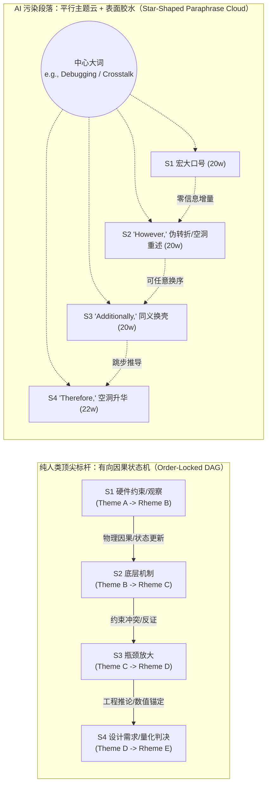

# Dimension 7 专项深度报告：段落内部句间逻辑关系、旧→新信息链与微论证结构

> **研究定位**：本报告针对计算机体系结构顶会（ISCA / MICRO / HPCA / ASPLOS，2011–2026）论文写作中 **AI 当前最隐蔽、最致命的结构性短板——段落内部句间逻辑与微论证拓扑（Intra-Paragraph Logical Topology）** 进行系统实证解剖。
> **数据纪律**：所有定量统计均基于 `corpus/manifest.json` 划定的 `macro_pool`（152 篇）与 `deep_read`（48 篇），全文逐词核验自 `corpus/macro_cache/<paper_id>.json`；**严格隔离 `held_out_test`（8 篇），零接触、零引用**。

---

## 0. 研究设计与双层实证语料总览

为了避免“印象派点评”或仅停留在浅层词频，本研究采用**宏观自动计量（Macro Stylometry）+ 微观逐句精读编码（Micro Sentence-by-Sentence Dissection）**双层证据链：

1. **宏观自动计量层（152 篇 `macro_pool` / 4,692 个洁净正文段落 / 25,701 句）**：
   - 自动过滤双栏水平交错页、参考文献表、图注表格与公式块，对 48 篇 `deep_read`（细分为 **2011–2022 纯人类获奖标杆 `exemplar_pre2023`** $n=22$、**2023–2026 获奖标杆 `exemplar_post2023`** $n=10$、**2011–2022 普通人类录用论文 `contrast_ordinary`** $n=10$、**2024–2026 AI 痕迹对照组 `contrast_post2023`** $n=6$）以及 152 篇 `macro_pool`（按三大年代 `2011–2015` / `2016–2022` / `2023–2026`）进行段落级连接词密度、裸指代与空壳指代、邻句尾→头词汇衔接（Given-New 代理指标）及段内句长变异系数（CV）计量。
2. **微观逐句手工编码层（45 个原文段落 / 268 句 / 223 处邻句转移）**：
   - 横跨 **5 大核心文体模态**（`Abstract` 9 段、`Introduction` 9 段、`Background/Motivation` 7 段、`Design Mechanism` 10 段、`Evaluation Analysis` 10 段）与 **4 大顶会**（ISCA / MICRO / HPCA / ASPLOS），精读并逐句拆解：
     - **纯人类获奖标杆（2011–2022）**：20 段（`P01–P20`，每模态 4 段）；
     - **后 2023 获奖标杆（洁净对照）**：2 段（`P21–P22`）；
     - **获奖论文罕见内聚失手案例**：2 段（`P23–P24`，分别来自 HPCA 2020 与 HPCA 2025 Best Paper，用于防止对获奖论文的神话化）；
     - **普通人类论文对照组（2011–2022 `contrast_ordinary`）**：10 段（`P25–P34`，每模态 2 段）；
     - **后 2023 AI 污染对照组（2024–2026 `contrast_post2023`）**：11 段（`P35–P45`，覆盖全部 6 篇对照论文与全部 5 大模态）。

### 表 0-1：双层实证核心指标跨层级对比总览

| 维度与指标 | 纯人类标杆 `exemplar_pre2023` (22 篇 / 精读 20 段) | 后 2023 获奖标杆 `exemplar_post2023` (10 篇 / 精读 2+2* 段) | 普通人类论文 `contrast_ordinary` (10 篇 / 精读 10 段) | 后 2023 AI 对照组 `contrast_post2023` (6 篇 / 精读 11 段) | 核心反差倍数 (`post2023` vs `pre2023`) |
| :--- | :---: | :---: | :---: | :---: | :---: |
| **【宏观】洁净正文段落 / 句数** | 721 段 / 3,849 句 | 374 段 / 2,069 句 | 292 段 / 1,688 句 | 134 段 / 710 句 | — |
| **【宏观】句首递进连接词（/100 句）** `Moreover/Furthermore/Additionally/In addition/Besides/Also,` | **1.17** | 1.69 | 1.78 | **4.08** | **3.49× ↑** |
| **【宏观】AI 三巨头递进词（/100 句）** `Moreover/Furthermore/Additionally,` | **0.78** | 1.35 | 1.07 | **2.68** | **3.44× ↑** |
| **【宏观】多连接词堆积段占比（≥2 句首连接词）** | **9.02%** | 15.51% | 9.59% | **14.18%** | **1.57× ↑** |
| **【宏观】裸指代句首（`This is/allows...`）** | **1.82%** | 4.48% | **3.01%** | 1.91% | 普通人类 **1.65× ↑** |
| **【宏观】空壳名词指代（`This approach/challenge...`）** | **0.38%** | 0.94% | 0.43% | **2.08%** | **5.47× ↑** |
| **【宏观】具象架构指代占全部指代比例** | **59.2%** | 43.9% | 48.9% | 53.1%（空壳占具名 31.6%） | 空壳占比 **3.0× ↑** |
| **【宏观】邻句尾→头词汇衔接率（Given-New 代理）** | **38.4%** | 36.1% | 38.4% | **28.5%** | **-9.9 pp ↓** |
| **【宏观】无重叠无锚点跳变率** | 21.2% | 19.8% | 17.7% | **25.5%** | **+4.3 pp ↑** |
| **【宏观】段内句长变异系数（Mean CV, ≥4 句段）** | **0.423** | 0.418 | 0.386 | **0.362** | 节奏压缩 **-14.4%** |
| **【宏观】含短转折句（≤13 词）段落占比** | **75.8%** | 79.2% | 67.1% | **64.0%** | **-11.8 pp ↓** |
| **【微观】邻句有效推进率（`GN+CT+ST`）** | **100.0%** (92/92) | 100.0% (11/11) | 67.2% (39/58) | **57.7%** (30/52) | **-42.3 pp ↓** |
| **【微观】纯粹旧→新链（`GN`）占比** | **82.6%** (76/92) | 72.7% (8/11) | 46.6% (27/58) | **42.3%** (22/52) | **-40.3 pp ↓** |
| **【微观】乒乓跳变/复读断链（`PP`）占比** | **0.0%** (0/92) | 0.0% (0/11) | 32.8% (19/58) | **42.3%** (22/52) | 灾难性飙升 |
| **【微观】乱序测试通过率（Shuffle Test PASS）** | **100.0%** (20/20) | 100.0% (2/2) | 50.0% (5/10) | **45.5%** (5/11) | 超过半数可乱序 |
| **【微观】去连接词测试通过率（Connector-Del PASS）** | **100.0%** (20/20) | 100.0% (2/2) | 40.0% (4/10) | **36.4%** (4/11) | 近 2/3 依赖假胶水 |
| **【微观】检出六大病灶段落占比（总病灶数）** | **0.0%** (0) | 0.0% (0)* | 80.0% (17 例) | **100.0%** (29 例) | 每段均 2.64 个病灶 |

> *注：表 0-1 中微观层将 2 段刻意挑选的获奖论文罕见失手案例（`P23` SIGMA 2020 与 `P24` DynamoLLM 2025）单独列出于第 5.7 节深入剖析，不与 `P21–P22` 洁净样本混淆。152 篇全库按年代的演变趋势完全印证上述发现：从 `2016–2022`（$n=65$，2,136 段）到 `2023–2026`（$n=40$，1,240 段），全库句首显性连接词率从 **9.02** 跃升至 **12.08/100 句（+33.9%）**，AI 三巨头递进词从 **0.98** 跃升至 **1.74/100 句（+77.6%）**，多连接词堆积段从 **10.39%** 飙升至 **15.40%（+48.2%）**，而尾→头词汇衔接率由 `2011–2015` 的 **38.8%** 持续下滑至 `2023–2026` 的 **34.4%**。*

---

## 1. 问题本质拆解：为什么 AI 段落"逐句通顺、整段散架"

大语言模型在英文学术写作中最具迷惑性的能力，是**极高的局部句级流畅度（Local Sentence-Level Fluency）**——几乎没有语法错误、动词搭配华丽、从句工整。但在体系结构顶会审稿人眼中，大量后 2023 论文的段落读起来却像“棉花里裹着塑料”：每一句单独看都像好英文，连读四句却感觉大脑空转、不知所云。

通过对 45 段原文的微观拓扑拆解，我们发现这一现象的根本原因在于**两种完全不同的生成机制**：

### 1.1 局部流畅度（Markov 表面平滑）vs 段内逻辑拓扑（硬件因果 DAG）

1. **纯人类顶会大师写段落，是在推演一个硬件状态机（State-Transition Graph）**：
   - 在体系结构中，每一个机制都有严格的物理/时间/数据依赖（例如：字线电压反复翻转 $\rightarrow$ 电荷泵来不及恢复 $\rightarrow$ 升压变慢 $\rightarrow$ 邻行耦合扰动变弱）。
   - 因此，作者写作时几乎**不需要费心去想“下一句该用什么过渡词”**——上一句的**输出状态（Rheme）**天然就是下一句的**输入前提（Theme）**。每一句都必须交付不可删减的**逻辑增量（$\Delta \text{Logic} > 0$）**，句序被物理因果锁死（乱序测试 100% 破坏逻辑）。
2. **LLM 写段落，是在对同一个 Prompt 中心词进行“星型语义采样（Star-Shaped Topic Cloud）”**：
   - 自回归模型在生成 $S_{i+1}$ 时，虽然条件依赖于前文，但其目标函数奖励的是“与段落主题词高度语义相关且语言精致的续写”，而非“验证 $S_{i+1}$ 相对于 $S_i$ 是否有非零硬件信息增量”。
   - 结果是 $S_1, S_2, S_3, S_4$ 各自独立地指向同一个抽象主题（如 `Hestia` P41 的 4 句全部在说“多层级解释器让调试更有效”），句子之间缺乏真实的状态传递。
   - 为了掩盖这种**拓扑上的星型扁平**，LLM 会条件反射式地注入两类“伪内聚补偿物”：
     1. **显性话语胶水（Explicit Discourse Glue）**：狂塞 `Furthermore,`（3.3×）、`Additionally,`（14.4×）、`Consequently,`（3.1×）、`Therefore,`（2.4×）、`Notably,`（10.8×）；
     2. **空壳名词指代（Hollow Shell-Noun Demonstratives）**：用 `This approach / These merits / These challenges / Such findings`（5.5×）制造“承上启下”的语法幻觉，实际上并未咬住任何具体的硬件实体。

### 1.2 三层语料的本质分野：纯人类标杆 vs 普通人类论文 vs 后 2023 AI 污染段

一个极具洞察力的实证发现是：**“普通人类写得不好”和“AI 写得不好”在病理谱系上截然不同！**

| 比较维度 | 纯人类标杆 (`exemplar_pre2023`) | 普通人类论文 (`contrast_ordinary`) | 后 2023 AI 污染段 (`contrast_post2023`) |
| :--- | :--- | :--- | :--- |
| **核心优势** | 强物理因果链、零冗余增量、角色耦合节奏 | 底层机制和实验数据真实扎实 | 单句语法无懈可击、学术辞藻华丽 |
| **主要缺陷** | 偶见终稿补丁导致单段末尾漂移（如 SIGMA P23） | **裸指代混乱**（`It` 跨 5 句指代）、**扁平罗列**（逐个报 benchmark 数字）、长难句臃肿 | **同义复读**（8/11 段）、**假连接词**（7/11 段）、**因果跳步/幻觉归因**（5/11 段）、**空壳名词指代**（5.5×）、**20 词传送带节奏** |
| **信息密度** | 极高，每句必有硬件实体或状态变更 | 中高，细节多但组织松散、重点不突出 | **外密内空**，高抽象形容词密度掩盖零机制增量 |
| **审稿人直觉** | “清晰、锋利、有说服力，一气呵成” | “工作扎实，但写得有点啰嗦/乱，得自己梳理” | “像 ChatGPT 润色的套话，说了半天没讲清物理机制” |

---

## 2. 逐句微逻辑弧线拆解：19 段顶尖标杆解剖与 8 大规范骨架

以下我们从 5 大核心写作模态中精选 **19 个纯人类/获奖标杆原文段落**（全部核验自 `macro_cache`，零删改），逐句标注其**词数**、**句间逻辑增量标签**与**旧→新锚点**，并提炼出顶会大师反复使用的 **8 大规范段内逻辑骨架（Canonical Intra-Paragraph Skeletons）**。

> **微逻辑增量标签体系（9 类原子操作）**：
> - `[Claim / Thesis]`：核心论断、目标声明或核心见解
> - `[Physical/Architectural Mechanism]`：硬件结构、电路/微架构原理或协议动作
> - `[Causal Consequence]`：物理或系统级因果推演结果
> - `[Quantitative Evidence / Anchor]`：具体数值、公式、规模边界或真实系统锚点
> - `[Contrast / Tension Pivot]`：反差转折、冲突揭示或悖论发问
> - `[Elimination of Strawman]`：排除直观替代方案并指明其硬伤
> - `[Concrete Instantiation / Example]`：具体指令序列、图例追踪或工作负载实例
> - `[Boundary / Caveat / Scope]`：适用边界、前提假设或退化情形
> - `[Next-Step State Dependency]`：状态机推进中的下一步条件与不变式

---

### 2.1 Abstract 模态逐句拆解（4 例）

#### 【标杆 P01】SALP — 银行串行化到 Subarray 洞察（SALP, ISCA 2012, `conf__isca__KimSLLM12`, p. 1, Abstract Para 1）
> **原文**：*Modern DRAMs have multiple banks to serve multiple memory requests in parallel. However, when two requests go to the same bank, they have to be served serially, exacerbating the high latency of off-chip memory. Adding more banks to the system to mitigate this problem incurs high system cost. Our goal in this work is to achieve the benefits of increasing the number of banks with a low cost approach. To this end, we propose three new mechanisms that overlap the latencies of different requests that go to the same bank. The key observation exploited by our mechanisms is that a modern DRAM bank is implemented as a collection of subarrays that operate largely independently while sharing few global peripheral structures.*

- **S1 (12w)** `[Physical/Architectural Mechanism]`：`Modern DRAMs have multiple banks` $\rightarrow$ `serve multiple memory requests in parallel.`（建立基线能力）
- **S2 (22w)** `[Contrast / Tension Pivot] + [Causal Consequence]`：`However, when two requests go to the same bank`（咬住 S1 尾部的 `multiple banks / memory requests`）$\rightarrow$ `served serially, exacerbating the high latency of off-chip memory.`
- **S3 (14w)** `[Elimination of Strawman]`：`Adding more banks ... to mitigate this problem`（锚定 S2 冲突）$\rightarrow$ `incurs high system cost.`
- **S4 (21w)** `[Claim / Thesis]`：`Our goal` $\rightarrow$ 整合 S3 矛盾的两极：`benefits of increasing the number of banks` + `low cost approach.`
- **S5 (21w)** `[Physical/Architectural Mechanism]`：`To this end, we propose three new mechanisms` $\rightarrow$ `overlap the latencies of different requests ... same bank.`
- **S6 (30w)** `[Physical/Architectural Mechanism]`：`The key observation exploited by our mechanisms`（锚定 S5）$\rightarrow$ `a modern DRAM bank is implemented as a collection of subarrays that operate largely independently...`（落到物理电路实现）
- **拓扑判定**：5/5 `GN` 链，CV=0.321，乱序即毁，零废话。

#### 【标杆 P02】InvisiSpec — 极简四句安全问题建模（InvisiSpec, MICRO 2018, `conf__micro__YanCS0FT18`, p. 1, Abstract Para 1）
> **原文**：*Hardware speculation offers a major surface for micro-architectural covert and side channel attacks. Unfortunately, defending against speculative execution attacks is challenging. The reason is that speculations destined to be squashed execute incorrect instructions, outside the scope of what programmers and compilers reason about. Further, any change to micro-architectural state made by speculative execution can leak information.*

- **S1 (13w)** `[Claim / Thesis]`：`Hardware speculation` $\rightarrow$ `major surface for micro-architectural covert and side channel attacks.`
- **S2 (8w!)** `[Contrast / Tension Pivot]`：`Unfortunately, defending against speculative execution attacks is challenging.`（8 词短锤立起悬念，紧接 S1 尾部的 `attacks`）
- **S3 (22w)** `[Physical/Architectural Mechanism]`：`The reason is that` $\rightarrow$ 第一层根因：被冲刷（squashed）的投机路径执行程序员/编译器语义之外的指令。
- **S4 (13w)** `[Causal Consequence]`：`Further, any change to micro-architectural state ... can leak information.`（第二层根因：微架构状态变更本身构成泄露通道，与 S3 构成“语义不可见 + 硬件留痕”双必要条件）
- **拓扑判定**：2 `GN` + 1 `CT`，句长轮廓 `13w -> 8w -> 22w -> 13w`（CV=0.416），堪称 Abstract 问题段教科书。

#### 【标杆 P03】Vector Runahead — 8 词匕首反转（Vector Runahead, ISCA 2021, `conf__isca__NaithaniA0E21`, p. 1, Abstract Para 2）
> **原文**：*Runahead execution is a tempting proposition for hiding latency in program execution. However, to achieve high memory-level parallelism, a standard runahead execution skips ahead of cache misses. In modern workloads, this means it only prefetches the first cache-missing load in each dependent chain. We argue that this is not a fundamental limitation. If runahead were instead to stall on cache misses to generate dependent chain loads, then it could regain performance if it could stall on many at once.*

- **S1 (12w)** `[Elimination of Strawman]`：立起靶子 `Runahead execution`（诱人的延迟隐藏方案）。
- **S2 (15w)** `[Contrast / Tension Pivot] + [Physical/Architectural Mechanism]`：`However,` $\rightarrow$ 揭示其核心机制缺陷：`skips ahead of cache misses.`
- **S3 (16w)** `[Causal Consequence]`：`In modern workloads, this means` $\rightarrow$ 只预取依赖链上的**第一个**缺失访存（`only prefetches the first cache-missing load in each dependent chain`）。
- **S4 (9w!)** `[Contrast / Tension Pivot]`：`We argue that this is not a fundamental limitation.`（9 词短句硬切反转！）
- **S5 (27w)** `[Physical/Architectural Mechanism]`：`If runahead were instead to stall on cache misses ... if it could stall on many at once.`（精准反转 S2 的 `skips` $\rightarrow$ `stall on many at once`，直接引出向量化核心思路）
- **拓扑判定**：`12w -> 15w -> 16w -> 9w -> 27w`（CV=0.433），无任何冗余形容词。

#### 【标杆 P21】Pond — 纯粹旧→新阶梯（Pond, ASPLOS 2023, `conf__asplos__LiBHEZNSRLAHFB23`, p. 1, Abstract）
> **原文**：*Public cloud providers seek to meet stringent performance requirements and low hardware cost. A key driver of performance and cost is main memory. Memory pooling promises to improve DRAM utilization and thereby reduce costs. However, pooling is challenging under cloud performance requirements. This paper proposes Pond, the first memory pooling system that both meets cloud performance goals and significantly reduces DRAM cost.*

- **S1 (13w)** `[Claim / Thesis]`：尾部引出双目标 `performance requirements and low hardware cost`。
- **S2 (10w)** `[Quantitative Evidence / Anchor]`：头部直承 `performance and cost`，尾部锁定硬件对象 **`main memory`**。
- **S3 (11w)** `[Physical/Architectural Mechanism]`：头部直承 **`Memory pooling`**，尾部指向 **`reduce costs`**。
- **S4 (8w!)** `[Contrast / Tension Pivot]`：`However,` 头部直承 **`pooling`**，尾部回扣 S1 的另一极 **`cloud performance requirements`**。
- **S5 (20w)** `[Claim / Thesis]`：提出 `Pond`，精确闭合双极张力（`meets cloud performance goals` + `reduces DRAM cost`）。
- **拓扑判定**：4/4 完美 `GN` 尾→头锁链，四句极短铺垫（13-10-11-8w）+ 20w 解决方案爆发！

---

### 2.2 Introduction 模态逐句拆解（4 例）

#### 【标杆 P05】SALP — 分支主题三路排除法（SALP, ISCA 2012, `conf__isca__KimSLLM12`, p. 1, Intro Para 4）
> **原文**：*A solution to the bank conflict problem is to increase the number of DRAM banks in the system. While current memory subsystems theoretically allow for three ways of doing so, they all come at a significantly high cost. First, one can increase the number of banks in the DRAM chip itself. However, for a constant storage capacity, increasing the number of banks-per-chip significantly increases the DRAM die area (and thus chip cost) due to replicated decoding logic, routing, and drivers at each bank [66]. Second, one can increase the number of banks in a channel by multiplexing the channel with many memory modules, each of which is a collection of banks. Unfortunately, this increases the electrical load on the channel, causing it to run at a significantly reduced frequency [8, 9]. Third, one can add more memory channels to increase the overall bank count. Unfortunately, this increases the pin-count in the processor package, which is an expensive resource. Considering both the low growth rate of pin-count and the prohibitive cost of pins in general, it is clear that increasing the number of channels is not a scalable solution.*

- **S1 (18w)** `[Elimination of Strawman]`：提出直观解（增加 DRAM bank 数量）。
- **S2 (20w)** `[Claim / Thesis]`：声明分支总纲（`three ways ... all come at a significantly high cost`）。
- **S3 (13w) -> S4 (33w)** `[Split Branch 1: 方案 -> 物理代价]`：片内增 bank $\rightarrow$ `However,` 译码器/布线/驱动器复制推高 die area。
- **S5 (27w) -> S6 (20w)** `[Split Branch 2: 方案 -> 物理代价]`：通道复用多模组 $\rightarrow$ `Unfortunately,` 电气负载上升导致降频。
- **S7 (13w) -> S8 (14w) -> S9 (30w)** `[Split Branch 3: 方案 -> 物理代价 -> 扩展性判决]`：增加通道数 $\rightarrow$ `Unfortunately,` 推高封装引脚数 $\rightarrow$ 引脚增速慢且昂贵，不可扩展。
- **精妙之处**：三个分支严格遵循对称的 **[直观方案 (13-27w) $\rightarrow$ 物理/电路否决 (14-33w)]** 微结构，拒绝空泛的 “impractical/infeasible”，全部给出硬核电路约束（die area / electrical load / pin-count）。

#### 【标杆 P06】RowHammer — 纯物理因果阶梯（RowHammer, ISCA 2014, `conf__isca__KimDKFLLWLM14`, p. 1, Intro Para 4）
> **原文**：*We identify the root cause of DRAM disturbance errors as voltage fluctuations on an internal wire called the wordline. DRAM comprises a two-dimensional array of cells, where each row of cells has its own wordline. To access a cell within a particular row, the row’s wordline must be enabled by raising its voltage — i.e., the row must be activated. When there are many activations to the same row, they force the wordline to toggle on and off repeatedly. According to our observations, such voltage fluctuations on a row’s wordline have a disturbance effect on nearby rows, inducing some of their cells to leak charge at an accelerated rate. If such a cell loses too much charge before it is restored to its original value (i.e., refreshed), it experiences a disturbance error.*

- **S1 (19w)** `[Claim / Thesis]`：直接定性根因：`voltage fluctuations on an internal wire called the wordline.`
- **S2 (16w)** `[Physical/Architectural Mechanism]`：建立空间结构：二维单元阵列 $\rightarrow$ 每行拥有独立 **`wordline`**。
- **S3 (25w)** `[Physical/Architectural Mechanism]`：建立访问触发：访问行内单元 $\rightarrow$ 抬高 **`wordline`** 电压（即 **`activated`**）。
- **S4 (19w)** `[Next-Step State Dependency]`：承接 **`activations`** $\rightarrow$ 高频激活迫使 **`wordline to toggle on and off repeatedly`**。
- **S5 (30w)** `[Causal Consequence]`：承接 **`such voltage fluctuations`** $\rightarrow$ 扰动邻行单元，迫使其 **`leak charge at an accelerated rate`**。
- **S6 (23w)** `[Causal Consequence]`：承接 **`such a cell loses too much charge`**（在刷新前）$\rightarrow$ 闭合回 S1 的 **`disturbance error`**！
- **惊人事实**：全段 **6 句、0 个显性递进/因果连接词**（无 `Therefore`/`Thus`/`Moreover`/`Furthermore`/`Consequently`），全靠 `wordline -> activated -> many activations -> toggle -> such voltage fluctuations -> leak charge -> loses too much charge -> disturbance error` 的无缝物理因果链咬合！

#### 【标杆 P07】MorphCore — 前人方案拆解与双根因狙击（MorphCore, MICRO 2012, `conf__micro__KhubaibSHWP12`, p. 1, Intro Para 3）
> **原文**：*To overcome this limitation of ACMPs, researchers have proposed CoreFusion-like architectures [16, 5, 17, 25, 24, 32, 9, 10]. They propose a chip with small cores to provide high throughput performance in multi-threaded programs. These small cores can dynamically “fuse” into a large core when executing single-threaded programs. Unfortunately, the fused large core has low performance and high power/energy consumption compared to a traditional out-of-order core for two reasons: 1) there are additional latencies among the pipeline stages of the fused core, thus, increasing the latencies of the core’s “critical loops”, and 2) mode switching requires instruction cache flushes and incurs the cost of data migration among the data caches of small cores.*

- **S1 (19w)** `[Elimination of Strawman]`：承接上段 `this limitation of ACMPs`，引出 `CoreFusion-like architectures`。
- **S2 (15w)** `[Physical/Architectural Mechanism]`：先公允说明其多核基础（`chip with small cores`）。
- **S3 (14w)** `[Physical/Architectural Mechanism]`：承接 `These small cores` $\rightarrow$ 动态融合机制（`dynamically "fuse" into a large core`）。
- **S4 (65w)** `[Contrast / Tension Pivot] + [Causal Consequence]`：`Unfortunately, the fused large core`（咬住 S3 尾部）$\rightarrow$ 两点微架构死穴：(1) 跨核融合拉长关键环路延迟；(2) 模式切换导致 I-cache 冲刷与数据迁移。
- **节奏启示**：三句短平快铺陈（19w-15w-14w）把靶子立稳，再以一句 65w 高密度双因重锤一次性击穿（CV=0.871）。

#### 【标杆 P08】Autonomous NIC Offloads — 11 词悖论到工业界实证（Autonomous NIC Offloads, ASPLOS 2021, `conf__asplos__PismennyEYL0T21`, p. 2, Intro Para 2）
> **原文**：*Despite their seemingly ideal suitability, L5P NIC offloads are not pervasive. The reason: existing designs assign NICs with the role of handling the L5P, which in turn necessitates that the NICs also handle layer≤4 functionality upon which the L5P depends, most notably that of TCP/IP [11, 22, 47, 48]. Such offload dependence is undesirable, as implementing TCP in hardware encumbers innovation in the network stack [86], and it slows down fixes when robustness [99] or security issues [53, 102] arise. For these reasons, Linux does not support TCP offloads [25, 69], and Windows recently deprecated such support [84].*

- **S1 (11w!)** `[Contrast / Tension Pivot]`：反差立论——明明最合适，却并不普及（`not pervasive`）。
- **S2 (38w)** `[Physical/Architectural Mechanism]`：`The reason:` 冒号直揭根因——现有卸载迫使 NIC 接管底层 TCP/IP。
- **S3 (31w)** `[Causal Consequence]`：用凝练命名名词 **`Such offload dependence`** 锚定 S2，推演两大工程恶果（扼杀协议栈创新 + 拖慢安全/健壮性修复）。
- **S4 (18w)** `[Quantitative Evidence / Anchor]`：`For these reasons,` 给出不可辩驳的现实系统铁证（Linux 不支持、Windows 已弃用）。

---

### 2.3 Background / Motivation 模态逐句拆解（3 例）

#### 【标杆 P09】Eyeriss — 8 词量化锚点与根本矛盾揭示（Eyeriss, ISCA 2016, `conf__isca__ChenES16`, p. 4, Sec III-B）
> **原文**：*The second issue can be handled by proper operation scheduling so that the generated psums can be reduced as soon as possible to save both the storage space and memory R/W energy. CR2 psums are reduced into one ofmap pixel. Unfortunately, maximum input data reuse cannot be achieved simultaneously with immediate psum reduction, since the psums generated by MACs using the same filter or ifmap value are not reducible. In order to achieve high throughput and energy efficiency, the underlying CNN dataflow needs to account for both input data reuse and psum accumulation scheduling at the same time.*

- **S1 (32w)** `[Physical/Architectural Mechanism]`：提出目标机制：通过算子调度尽早规约 `psums`，节省存储与读写能耗。
- **S2 (8w!)** `[Quantitative Evidence / Anchor]`：`CR2 psums are reduced into one ofmap pixel.`（8 词冷峻量化规约比例）
- **S3 (29w)** `[Contrast / Tension Pivot] + [Physical/Architectural Mechanism]`：`Unfortunately,` 揭示硬核数学冲突——最大输入复用与即时部分和规约**不可兼得**，因为共享同一 filter/ifmap 的 MAC 产出的 psum 属于不同输出像素（不可直接相加）。
- **S4 (29w)** `[Claim / Thesis]`：导出数据流设计的硬性需求——必须协同优化二者。

#### 【标杆 P10】Swarm — 概念→具体图例追踪→软件代价→硬件瓶颈（Swarm, MICRO 2015, `conf__micro__JeffreySYES15`, p. 2, Sec 2.1）
> **原文**：*A distinctive feature of irregular parallel programs is that task creation and execution order are different: children tasks are not immediately runnable, but are subject to a global order influenced by all other tasks in the program. For example, in Fig. 1(c), (C, 2) creates (B, 4), but running (B, 4) immediately would produce the wrong result, as (B, 3), created by a different parent, must run first. Sequential implementations of these programs use scheduling data structures, such as priority or FIFO queues, to process tasks in the right order. These scheduling structures introduce false data dependences that restrict parallelism and hinder TLS (Sec. 3).*

- **S1 (37w)** `[Claim / Thesis]`：抽象性质定义——任务创建序 $\neq$ 全局执行序。
- **S2 (31w)** `[Concrete Instantiation / Example]`：`For example,` 立刻用图例中的具体任务节点 `(C, 2) -> (B, 4)` 与 `(B, 3)` 证明为什么立即执行会算错。
- **S3 (22w)** `[Physical/Architectural Mechanism]`：切入现有串行实现如何解决该问题（优先级队列 / FIFO 队列）。
- **S4 (15w)** `[Causal Consequence]`：用具象名词 **`These scheduling structures`** 咬住 S3，收束出核心瓶颈——引入伪数据依赖，扼杀并发与 TLS。

#### 【标杆 P11】Amdahl's Law Market — 极简交互循环与收敛保证（Amdahl's Law Market, HPCA 2018, `conf__hpca__ZahediLL18`, p. 2, Sec II-C）
> **原文**：*A market is a natural framework for trading cores in users’ entitlements. Users spend their budgets on cores that are most beneficial. In effect, users trade their spare cores on one server for extra cores on others. The market sets prices for cores according to server capacities and user demands. Given prices, users bid for servers’ cores based on their jobs’ demands. The market collects bids, sets new prices, and permits users to revise bids. This process repeats until prices converge to stationary values. When users’ budgets are set in proportion to their datacenter-wide entitlements, the market guarantees proportional shares across the datacenter.*

- **S1 (12w)** `[Claim / Thesis]`：提出市场机制总括（`market` + `trading cores` + `users' entitlements`）。
- **S2 (10w) -> S3 (15w)** `[Physical/Architectural Mechanism]`：用户视角——花预算买最有益的核心 $\rightarrow$ 本质是用某台机器的空闲核换另一台机器的额外核。
- **S4 (13w) -> S5 (12w) -> S6 (13w)** `[Next-Step State Dependency]`：绝妙的双主体乒乓闭环！**市场定价 (`prices`)** $\rightarrow$ **`Given prices,` 用户出价 (`bids`)** $\rightarrow$ **市场收价 (`collects bids`) 并调价 (`new prices`) 允许重出价**。
- **S7 (9w!)** `[Boundary / Caveat / Scope]`：`This process repeats until prices converge to stationary values.`（9 词终止条件）
- **S8 (19w)** `[Causal Consequence]`：收束核心不变式——预算与配额成正比即保证全数据中心公平份额。
- **亮点**：8 句平均仅 12.9 词，**0 个 `Moreover`/`Therefore`/`Furthermore`**，靠 `prices -> Given prices -> bids -> collects bids -> This process` 织就精密闭环！

---

### 2.4 Design Mechanism 模态逐句拆解（4 例）

#### 【标杆 P13】FireSim — 硬件模块状态机与运行时语义（FireSim, ISCA 2018, `conf__isca__KarandikarMKBAL18`, p. 4, Sec III-A-2）
> **原文**：*The final module in the send path is the rate limiter, which allows NIC bandwidth to be limited at runtime using a token-bucket algorithm. Essentially, the limiter holds a counter that is decremented every time a network flit is sent and incremented by k every p cycles. Flits can be forwarded from input to output so long as the count is greater than zero. This makes the effective bandwidth k/p times the unlimited rate. The values k and p can be set at runtime, allowing simulation of different bandwidths without resynthesizing the RTL. Unlike external throttling of requests, this internal throttling appropriately backpressures the NIC, so it behaves as if it actually operated at the set bandwidth.*

- **S1 (24w)** `[Physical/Architectural Mechanism]`：模块定位与算法选型（`rate limiter` + `token-bucket`）。
- **S2 (23w)** `[Next-Step State Dependency]`：状态寄存器定义与增减规则（`counter`: 发 flit 减 1，每 $p$ 周期加 $k$）。
- **S3 (17w)** `[Next-Step State Dependency]`：转发门控条件（`count > 0` 才转发 flits）。
- **S4 (10w!)** `[Causal Consequence]`：直接导出数学后果（有效带宽 $= k/p$ 倍无限制速率）。
- **S5 (19w)** `[Quantitative Evidence / Anchor]`：锚定变量 **`The values k and p`** $\rightarrow$ 运行时可配置，避免重新综合 RTL。
- **S6 (24w)** `[Contrast / Tension Pivot]`：对比外部限流（`Unlike external throttling`）$\rightarrow$ **`this internal throttling`** 提供真实硬件反压（backpressure）。
- **拓扑判定**：5/5 `GN` 锁死链（`limiter -> counter -> count -> k/p -> values k and p -> internal throttling`），零多余过渡词！

#### 【标杆 P14】Swarm — 硬件不变式与边界反例证明（Swarm, MICRO 2015, `conf__micro__JeffreySYES15`, p. 6, Sec 4.4）
> **原文**：*The key invariant that allows caches to filter checks is that, when a task with virtual time T installs a line in the (L1 or L2) cache, that line has no conflicts with tasks of virtual time > T . As long as the line stays cached with the right coherence permissions, it stays conflict-free. Because conflicts happen when tasks access lines out of virtual time order, if another task with virtual time U > T accesses the line, it is also guaranteed to have no conflicts. However, accesses from a task with virtual time U < T must trigger conflict checks, as another task with intermediate virtual time X, U < X < T , may have accessed the line. U ’s access does not conflict with T ’s, but may conflict with X’s.*

- **S1 (40w)** `[Claim / Thesis]`：立下核心不变式——虚拟时间 $T$ 安装的缓存行对所有 $>T$ 的任务无冲突。
- **S2 (15w)** `[Boundary / Caveat / Scope]`：维持条件——只要缓存行保持有效一致性权限，即维持无冲突。
- **S3 (32w)** `[Causal Consequence]`：正向推导安全区——$U > T$ 必然免检。
- **S4 (34w)** `[Contrast / Tension Pivot] + [Boundary / Caveat / Scope]`：`However,` 严格切出危险边界 $U < T$——必须触发冲突检测，因为可能存在中间虚拟时间 $U < X < T$。
- **S5 (14w)** `[Concrete Instantiation / Example]`：一剑封喉点破反直觉本质——$U$ 不与 $T$ 冲突，但可能与 $X$ 冲突！

#### 【标杆 P15】InvisiSpec — 协议扩展→竞态处理→无饥饿证明（InvisiSpec, MICRO 2018, `conf__micro__YanCS0FT18`, p. 9, Sec VI-E-1）
> **原文**：*InvisiSpec adds a new Spec-GetS coherence transaction, which obtains a copy of the latest version of a cache line from the cache hierarchy without changing any cache or coherence states. For instance, in a directory protocol, a Spec-GetS obtains the line from the directory if the directory owns it; otherwise, the directory forwards the request to the owner, which sends a copy of the line to the requester. The directory does not order forwarded Spec-GetS requests with respect to other coherence transactions, to avoid making any state changes. For this reason, if a forwarded Spec-GetS arrives at a core after the core has lost ownership of the line, the Spec-GetS is bounced back to the requester, which retries. The requesting USL cannot starve as a result of such bounces, because eventually it either gets squashed or becomes safe. In the latter case, it then issues a standard coherence transaction.*

- **S1 (30w)** `[Physical/Architectural Mechanism]`：定义新事务 `Spec-GetS` 及其核心约束（不改变任何缓存/一致性状态）。
- **S2 (38w)** `[Concrete Instantiation / Example]`：`For instance,` 落到目录协议的两种转发路径（目录拥有 vs 转发给 owner）。
- **S3 (20w)** `[Boundary / Caveat / Scope]`：从 S1 约束推导出设计抉择——目录**不对转发请求排序**（避免改变状态）。
- **S4 (30w)** `[Causal Consequence]`：`For this reason,` 诚实面对竞态副作用——到达时原 owner 已失权 $\rightarrow$ 弹回重试（`bounced back`）。
- **S5 (20w)** `[Causal Consequence]`：锚定 **`such bounces`**，主动回答审稿人最担心的问题——为什么不会活锁/饥饿（终将 squash 或变为 safe）。
- **S6 (11w!)** `[Next-Step State Dependency]`：`In the latter case, it then issues a standard coherence transaction.`（11 词干净收口状态机）

#### 【标杆 P16】Elastic Cuckoo Page Tables — 反事实假设→非一致回退机制（Elastic Cuckoo PT, ASPLOS 2020, `conf__asplos__SkarlatosKXT20`, p. 10, Sec 6.2）
> **原文**：*If the CWCs were coherent, updates to CWT entries would invalidate entries in the CWCs. In our evaluation, we do not make such assumption. In this case, when the page walker uses information found in CWCs to access a translation and the accesses fail, the walker performs the walk again. This time, however, it accesses the remaining ways of the target elastic cuckoo page table or, if a resize is in progress, the remaining ways of both tables. This action will find entries that have been moved to another way. After the translation is obtained, the stale entries in the CWCs are refreshed. A similar process is followed for the Rehashing Pointers.*

- **S1 (15w)** `[Boundary / Caveat / Scope]`：先立理想反事实假设（若 CWC 一致，则更新自动失效）。
- **S2 (9w!)** `[Contrast / Tension Pivot]`：9 词果断放弃强假设（`we do not make such assumption`）。
- **S3 (26w)** `[Next-Step State Dependency]`：触发条件与动作——用到陈旧 CWC 导致翻译失败 $\rightarrow$ 重新 walk。
- **S4 (28w)** `[Physical/Architectural Mechanism]`：`This time, however,` 精确限定重走路径（访问剩余 ways，或在 resize 期间访问新旧两表的剩余 ways）。
- **S5 (12w)** `[Causal Consequence]`：正确性保障——`This action` 必能找到迁移条目。
- **S6 (13w)** `[Next-Step State Dependency]`：拿到翻译后刷新陈旧 CWC。
- **S7 (9w!)** `[Boundary / Caveat / Scope]`：9 词复用声明——`Rehashing Pointers` 遵循同一流程。

---

### 2.5 Evaluation Analysis 模态逐句拆解（4 例）

#### 【标杆 P17】RowHammer — 趋势→反常拐点→13 词灵魂发问→电路级假说（RowHammer, ISCA 2014, `conf__isca__KimDKFLLWLM14`, p. 7, Sec 6.2）
> **原文**：*As the AI is varied between 55–500ns, Figure 5 plots the numbers of errors in the three modules. (Only the first bank is tested, and the RI is kept constant at 64ms.) For longer AIs, there are fewer errors because a row is opened less often, thereby diminishing its disturbance effect. When the AI is sufficiently long, the three modules have no errors: ~500ns, ~450ns, and ~250ns. At the shortest AIs, however, there is a notable reversal in the trend: B11 and C19 have fewer errors at 60ns than at 65ns. How can there be fewer errors when a row is opened more often? This anomaly can be explained only if the disturbance effect of opening a row is weaker at 60ns than at 65ns. In general, row-coupling effects are known to be weakened if the wordline voltage is not raised quickly while the row is being opened [55]. The wordline voltage, in turn, is raised by a circuit called the wordline charge-pump [38], which becomes sluggish if not given enough time to “recover” after performing its job. When a wordline is raised every 60ns, we hypothesize that the charge-pump is unable to regain its full strength by the end of each interval, which leads to a slow voltage transition on the wordline and, ultimately, a weak disturbance effect.*

- **S1 (19w) + S2 (14w)** `[Quantitative Evidence / Anchor]`：实验变量扫描范围与受控变量边界。
- **S3 (19w) -> S4 (16w)** `[Claim / Thesis] + [Quantitative Evidence / Anchor]`：主趋势（AI 越长错误越少，因开行频率降低）+ 零错误阈值锚点（500/450/250ns）。
- **S5 (24w)** `[Contrast / Tension Pivot]`：`At the shortest AIs, however,` 敏锐捕捉反常反转——60ns 错误反而少于 65ns！
- **S6 (13w!)** `[Contrast / Tension Pivot]`：13 词设问直接锁死读者注意力：`How can there be fewer errors when a row is opened more often?`
- **S7 (21w) -> S8 (24w) -> S9 (29w) -> S10 (41w)** `[Physical/Architectural Mechanism]` 四级连环电路溯源：
  - **`This anomaly`** $\rightarrow$ 60ns 单次开行扰动更弱；
  - 扰动变弱 $\rightarrow$ **`wordline voltage`** 抬升不够快；
  - **`The wordline voltage, in turn,`** $\rightarrow$ 由 **`wordline charge-pump`** 驱动，缺乏恢复时间会变迟钝；
  - 60ns 周期下 **`the charge-pump`** 来不及恢复满压 $\rightarrow$ 电压跃变缓慢 $\rightarrow$ 弱扰动效应！
- **评审价值**：这是全语料库最顶级的实验剖析段——它把“看图说话”升级为**侦探式的物理因果闭环**。

#### 【标杆 P18】Vector Runahead — 分支累加式消融归因（Vector Runahead, ISCA 2021, `conf__isca__NaithaniA0E21`, p. 10, Sec VI-A）
> **原文**：*Vector Runahead achieves higher performance by three main mechanisms. The most important is the software-pipelining effect that reordering of load instructions gives us, in that a large number of misses can be serviced simultaneously. This same reordering, implemented with 64 scalar micro-ops instead of 8 vector micro-ops, is still sufficient to gain an average 1.47× speedup. The optimization of packing these into fewer vector operations, due to their now-SIMD layout, increases performance to 1.69× by virtue of improving compute throughput and by requiring fewer issue queue slots so that loads can issue earlier. Finally, altering the termination condition, such that Vector Runahead completes the entire chain of memory accesses before exiting, allows it to cover longer chains, of multiple main memory accesses, rather than just the ones it can achieve before the head of the ROB returns, increasing performance to the full 1.79× shown in the graph.*

- **S1 (9w!)** `[Claim / Thesis]`：9 词总纲宣告三机制。
- **S2 (25w) -> S3 (22w)** `[Split Branch 1 + Quantitative Evidence]`：机制一（访存重排软流水）单独贡献 **`1.00× -> 1.47×`**（即使仅用 64 条标量微操作）。
- **S4 (37w)** `[Split Branch 2 + Physical Mechanism + Quantitative Evidence]`：机制二（SIMD 向量打包节省 IQ 槽位、提早发射 load）累加推进至 **`1.69×`**。
- **S5 (54w)** `[Split Branch 3 + Physical Mechanism + Quantitative Evidence]`：机制三（延后退出条件覆盖整条依赖链）累加封顶至 **`1.79×`**。
- **关键对比**：对照 `QPlacer` P43（“归功于其启发式方法”）或 `FastTTS` p. 9（堆砌形容词 `synergistic optimizations`），这里每加一句就推进一档定量加速比，并绑定精确微架构瓶颈（MSHR 并发 $\rightarrow$ IQ 槽位 $\rightarrow$ 依赖链深度）。

#### 【标杆 P19 & P20】PVCoherence 与 Amdahl's Law Market — 极简四句“疑虑证伪”与“异常点归因”
- **【标杆 P19】PVCoherence (HPCA 2014, `conf__hpca__ZhangBES14`, p. 10)**：
  - **S1 (9w!)** `[Boundary / Caveat / Scope]`：*PV-MOESI’s use of Completion messages can potentially hinder performance.*（主动立起审稿人疑虑）
  - **S2 (16w)** `[Physical/Architectural Mechanism]`：*While waiting for a Completion message on block B, the L2 stalls requests for block B.*（精确机制：L2 阻塞同块请求）
  - **S3 (28w)** `[Quantitative Evidence / Anchor]`：*To evaluate the performance impact of this L2 stalling, we inspected the fraction of requests that arrive at the L2 and must stall while waiting for a Completion.*（对症测量）
  - **S4 (25w)** `[Causal Consequence]`：*For all benchmarks, this fraction was well less than 1%, i.e., the use of Completions messages causes few stalls and has little impact on performance.*（定量证伪疑虑）
- **【标杆 P20】Amdahl's Law Market (HPCA 2018, `conf__hpca__ZahediLL18`, p. 6)**：
  - **S1 (9w!)** `[Contrast / Tension Pivot]`：*Canneal reports particularly high error because it is memory-intensive.*（异常点 + 一句话根因）
  - **S2 (15w)** `[Physical/Architectural Mechanism]`：*Its memory bandwidth utilization on small datasets is not representative of that on larger datasets.*（小数据集不代表大数据集带宽压力）
  - **S3 (12w)** `[Causal Consequence]`：*When smaller datasets under-estimate bandwidth constraints, they over-estimate speedups from additional processors.*（低估带宽瓶颈 $\rightarrow$ 高估多核加速比）
  - **S4 (15w)** `[Quantitative Evidence / Anchor]`：*The estimated parallel fraction is much larger than the one measured on the full dataset.*（精准落回图中指标误差）

---

### 2.6 提炼：体系结构顶会 8 大规范段内微论证骨架（Canonical Intra-Paragraph Skeletons）

归纳全部 22 个洁净标杆段落（`P01–P22`），顶会高手的段落绝非即兴散文，而是高度复用以下 **8 种有向微论证骨架**：

| 编号 | 规范骨架名称 | 典型适用模态 | 逐句有向状态链（Logic Arc） | 代表标杆 |
| :---: | :--- | :--- | :--- | :--- |
| **SK-1** | **双极张力闭环型** *(Dual-Constraint Tension Closure)* | Abstract / Intro | `基线目标(X+Y)` $\rightarrow$ `现有方案满足X` $\rightarrow$ `转折：破坏Y` $\rightarrow$ `本文系统同时闭环X与Y` | `Pond` (P21), `SALP` (P01) |
| **SK-2** | **物理根因瀑布型** *(Physical Root-Cause Cascade)* | Intro / Motivation | `宏观现象/根因定性` $\rightarrow$ `硬件结构` $\rightarrow$ `触发动作` $\rightarrow$ `物理效应放大` $\rightarrow$ `系统级失效` | `RowHammer` (P06), `Clearing the Clouds` (P12) |
| **SK-3** | **分支稻草人排除型** *(Split-Topic Strawman Elimination)* | Intro / Motivation | `直观解决方向` $\rightarrow$ `宣告K条路径皆有硬伤` $\rightarrow$ `路径1→物理代价1` $\rightarrow$ `路径2→物理代价2` $\rightarrow$ `路径3→扩展性判决` | `SALP` (P05), `MorphCore` (P07) |
| **SK-4** | **反直觉短锤反转型** *(Short-Pivot Reframing)* | Abstract / Intro | `主流方案看似可行` $\rightarrow$ `真实机制缺陷` $\rightarrow$ `负载后果` $\rightarrow$ **≤10 词短句推翻前提** $\rightarrow$ `反向机制洞察` | `Vector Runahead` (P03), `InvisiSpec` (P02), `Autonomous NIC` (P08) |
| **SK-5** | **具体追踪→结构瓶颈型** *(Concrete Trace -> Bottleneck)* | Background / Motivation | `抽象程序特征` $\rightarrow$ `具体图例/节点步进证明` $\rightarrow$ `现有软件补丁` $\rightarrow$ `伪依赖/硬件瓶颈` | `Swarm` (P10), `Eyeriss` (P09) |
| **SK-6** | **硬件状态机推进型** *(Hardware State-Machine Walkthrough)* | Design Mechanism | `模块职责` $\rightarrow$ `状态存储与更新条件` $\rightarrow$ `门控/动作` $\rightarrow$ `数学/性能推论` $\rightarrow$ `运行时/边界收益` | `FireSim` (P13), `Amdahl's Law Market` (P11), `Elastic Cuckoo` (P16) |
| **SK-7** | **不变式→竞态边界→活性证明型** *(Invariant -> Race Boundary -> Liveness Proof)* | Design Mechanism | `核心不变式/事务语义` $\rightarrow$ `常规安全路径` $\rightarrow$ `转折：违规/竞态边界` $\rightarrow$ `反例或弹回机制` $\rightarrow$ `无饥饿/正确性收束` | `Swarm` (P14), `InvisiSpec` (P15) |
| **SK-8** | **实验侦探归因型** *(Diagnostic Attribution & Outlier/Risk Audit)* | Evaluation Analysis | 子型 A：**主趋势 $\rightarrow$ 反常拐点 $\rightarrow$ 设问 $\rightarrow$ 电路假说**； 子型 B：**总增益 $\rightarrow$ 机制1($\Delta_1$) $\rightarrow$ 机制2($\Delta_2$) $\rightarrow$ 机制3($\Delta_3$)**； 子型 C：**疑虑/异常点 $\rightarrow$ 物理根因 $\rightarrow$ 针对性诊断指标 $\rightarrow$ 边界判决** | `RowHammer` (P17), `Vector Runahead` (P18), `PVCoherence` (P19), `Amdahl's Law` (P20), `Contiguitas` (P22) |

---

## 3. 信息流与主题推进机制（旧→新信息链 Given-New / Theme-Rheme 实证）

语言学中丹麦布拉格学派与 Halliday 的**主位-述位推进理论（Theme-Rheme / Given-New Progression）**在计算机体系结构论文中展现出惊人的工程解释力。我们定义一段内相邻两句 $(S_i \rightarrow S_{i+1})$ 的四种推进模式：

1. **线性旧→新链（Given-New Linear Chaining, `GN`）**：$S_i$ 后半句引入的**新信息（Rheme）**，直接成为 $S_{i+1}$ 句首或主语的**已知信息（Theme）**。形如 $A \rightarrow B;\ B \rightarrow C;\ C \rightarrow D$。这是硬件因果链的黄金骨架。
2. **恒定主题推进（Constant-Topic Progression, `CT`）**：$S_i$ 与 $S_{i+1}$ 保持同一聚焦主语（$A \rightarrow B;\ A \rightarrow C$），但每句必须交付严格正交的新属性或新阶段动作（绝非同义改写）。
3. **分裂主题推进（Split-Topic / Hypertheme Progression, `ST`）**：$S_1$ 显式宣告有限分支集合（如 `three ways`, `three main mechanisms`, `two setups`），后续句组严格按声明顺序逐一展开分支（$A \rightarrow \{B_1, B_2, B_3\};\ B_1 \rightarrow \dots;\ B_2 \rightarrow \dots$）。
4. **乒乓跳变 / 原地复读 / 断链（Topic Ping-Pong / Echo / Broken Jump, `PP`）**：相邻两句既无尾→头承接、又非声明分支，而是原地改写复读、无锚点切入新话题，或跨句倒挂指代。

### 3.1 实证量化对比（223 处手工编码转移 + 152 篇宏观词汇链验证）

#### 表 3-1：45 个精读段落（223 处邻句转移）主题推进模式分布

| 语料层级 | 段落数 | 总句数 | 邻句转移数 | 线性旧→新 `GN` | 恒定主题 `CT` | 分裂主题 `ST` | **有效推进合计** (`GN+CT+ST`) | **断链/乒乓/复读** `PP` |
| :--- | :---: | :---: | :---: | :---: | :---: | :---: | :---: | :---: |
| **纯人类标杆 (`exemplar_pre2023`)** | 20 | 112 | 92 | **76 (82.6%)** | 8 (8.7%) | 8 (8.7%) | **92 (100.0%)** | **0 (0.0%)** |
| **后 2023 获奖标杆 (`exemplar_post2023`)** | 2 | 13 | 11 | **8 (72.7%)** | 0 (0.0%) | 3 (27.3%) | **11 (100.0%)** | **0 (0.0%)** |
| **获奖论文罕见失手 (`exemplar_lapse`)** | 2 | 12 | 10 | 5 (50.0%) | 1 (10.0%) | 0 (0.0%) | 6 (60.0%) | **4 (40.0%)** |
| **普通人类论文 (`contrast_ordinary`)** | 10 | 68 | 58 | 27 (46.6%) | 5 (8.6%) | 7 (12.1%) | 39 (67.2%) | **19 (32.8%)** |
| **后 2023 AI 对照组 (`contrast_post2023`)** | 11 | 63 | 52 | **22 (42.3%)** | 4 (7.7%) | 4 (7.7%) | **30 (57.7%)** | **22 (42.3%)** |

#### 表 3-2：宏观自动化验证 — 邻句“尾半句→句首 10 词”实词重叠率（48 篇 `deep_read` & 152 篇 `macro_pool`）

| 数据集与层级 | 段落数 | 邻句对数 | 尾→头实词直链率 (`Tail-to-Head GN Proxy`) | 全句实词重叠率 | 无重叠无指代跳变率 (`Zero-Overlap Jump`) |
| :--- | :---: | :---: | :---: | :---: | :---: |
| `deep_read: exemplar_pre2023` ($n=22$) | 721 | 3,128 | **38.4%** | **76.2%** | 21.2% |
| `deep_read: exemplar_post2023` ($n=10$) | 374 | 1,695 | 36.1% | 76.6% | 19.8% |
| `deep_read: contrast_ordinary` ($n=10$) | 292 | 1,396 | 38.4% | 79.2% | 17.7% |
| `deep_read: contrast_post2023` ($n=6$) | 134 | 576 | **28.5% (-9.9 pp)** | **70.0%** | **25.5%** |
| `macro_pool: 2011–2015` ($n=47$) | 1,316 | 5,966 | **38.8%** | 78.1% | 19.2% |
| `macro_pool: 2016–2022` ($n=65$) | 2,136 | 9,518 | 36.8% | 75.4% | 21.8% |
| `macro_pool: 2023–2026` ($n=40$) | 1,240 | 5,525 | **34.4%** | 74.5% | 22.0% |

### 3.2 关键实证发现解读

1. **“82.6% vs 42.3%”的断崖差距**：在纯人类顶会标杆中，超过八成的相邻句子是严格的**尾→头线性旧→新锁链（`GN`）**；而 `contrast_post2023` 组近半数转移（42.3%）退化为乒乓跳变或同义复读（`PP`）。
2. **为什么普通人类论文在宏观“词汇重叠率”上看似很高（79.2%），微观有效推进却只有 67.2%？**
   - 精读揭开了这个极易误导人的统计现象：普通人类论文（如 `Scratchpad Coherence` P33、`TimeCache` P27）在扁平罗列时反复重复同一个系统名/指标词（`overhead`, `filter`, `cache`, `delay`），导致字面词汇重叠很高，但在**逻辑结构上属于可随意换序的平行罗列或同义打转**。
   - 反观 `contrast_post2023` 组，由于 LLM 刻意追求“同义词替换（Elegant Variation）”（例如 `Hestia` P41 在 4 句里把同一概念轮换写成 `comprehensive simulation approach -> multi-level interpretation -> multi-level debugger -> equivalence mapping`），导致**连表层尾→头实词链都暴跌 9.9 个百分点（38.4% $\rightarrow$ 28.5%）**！
3. **大师如何优雅使用 `GN` / `CT` / `ST` 组合拳**：
   - **纯 `GN` 链的极致示范**——`Pond` (P21)：`[performance & cost] -> [main memory] -> [Memory pooling -> reduce costs] -> [pooling -> cloud performance] -> [Pond -> performance + cost]`，读者眼球无需回扫即可一次顺读到底。
   - **受控 `CT` 的黄金上限**：在 20 段纯人类标杆中，恒定主题（`CT`）仅占 8.7%，且连续相同主语几乎不超过 **2–3 句**（如 `Amdahl's Law Market` P11 中 `Users spend... -> In effect, users trade...` 两句后立刻切到 `The market sets prices...`），避免机械排比感。
   - **`ST` 的硬性前置条件**：纯人类标杆**绝不凭空抛出 `First, ... Second, ...`**；使用 `ST` 前必有一句总纲锚定分支个数与维度（`three ways`, `three main mechanisms`, `two setups`），且每个分支内部重新回到 `GN` 因果链（如 `SALP` P05 每个 `First/Second/Third` 后必紧跟一句咬住该方案物理代价的 `GN` 否决句）。

---

## 4. 隐性物理因果 vs 显性过渡词（Implicit Semantic Causality vs Explicit Discourse Glue）

AI 写作最显眼的“指纹”之一，是在句子开头频繁贴附 `Moreover,`, `Furthermore,`, `Additionally,`, `Consequently,`, `Therefore,`, `Notably,` 等**显性话语连接词**。我们的全语料定量分析揭示了一个违背大众直觉的真相：**顶尖人类架构师极少依赖句首连接词来维系连贯性，他们超过 91% 的句子没有任何句首过渡词，却依然拥有铁板一块的因果推演力。**

### 4.1 句首显性连接词频次全景（每 1,000 句出现次数，48 篇 `deep_read` 洁净正文）

| 连接词类别 | 句首显性连接词 | `exemplar_pre2023` (纯人类标杆, 3,849 句) | `exemplar_post2023` (后 2023 获奖, 2,069 句) | `contrast_ordinary` (普通人类, 1,688 句) | `contrast_post2023` (AI 污染对照, 710 句) | `post2023` vs `pre2023` 倍率变化 |
| :--- | :--- | :---: | :---: | :---: | :---: | :---: |
| **递进胶水 (AI 重灾区)** | `Additionally,` | **0.78** | 5.32 | 4.15 | **11.27** | **14.45× ↑** |
| | `Furthermore,` | **3.90** | 5.32 | 4.74 | **12.68** | **3.25× ↑** |
| | `In addition,` | 3.38 | 2.42 | 3.55 | **5.63** | **1.67× ↑** |
| | `Moreover,` | 3.12 | 2.90 | 1.78 | 2.82 | 0.90× |
| **因果/结论胶水** | `Consequently,` | **1.82** | 2.42 | 1.18 | **5.63** | **3.09× ↑** |
| | `Therefore,` | **4.16** | 1.93 | 4.74 | **9.86** | **2.37× ↑** |
| | `Thus,` | 5.20 | **14.02** | 2.37 | 2.82 | (后 2023 获奖偏好) |
| | `Hence,` | **5.72** | 3.38 | 1.78 | **0.00** | 纯人类高频简洁词 |
| **转折/对比连接词** | `However,` | 19.49 | 30.93 | 18.96 | 22.54 | 1.16×（质变在真假转折） |
| | `Instead,` | 2.60 | 2.42 | 1.18 | 2.82 | — |
| | `In contrast,` | 3.12 | 4.35 | 3.55 | 2.82 | — |
| | `Unfortunately,` | **3.12** | 4.35 | 2.37 | 1.41 | 纯人类偏爱直陈痛点 |
| **强调/具象落地词** | `Notably,` | **0.52** | 1.93 | 0.00 | **5.63** | **10.83× ↑** |
| | **`For example,`** | **8.57** | **9.18** | 3.55 | **1.41** | **6.08× ↓（暴跌！）** |
| | `Specifically,` | 2.60 | 7.73 | 1.18 | 2.82 | — |
| **总显性连接词密度** | **每 100 句总计** | **8.52** | 11.99 | 8.00 | **11.55** | **1.36× ↑** |
| **段落内胶水堆积** | **≥2 个连接词段落占比** | **9.02%** | 15.51% | 9.59% | **14.18%** | **1.57× ↑** |
| | **AI 三巨头同段双叠占比** | **0.00%** | 0.27% | 0.00% | **0.75%** | 纯人类 **0 例**！ |

> **最震撼的反差组合**：在 `contrast_post2023` 组中，抽象填充词 **`Additionally,` 暴涨 14.5×、`Notably,` 暴涨 10.8×、`Furthermore,` 暴涨 3.3×、`Consequently,` 暴涨 3.1×**；与此同时，把抽象机制钉死到具体硬件例子的 **`For example,` 却暴跌 6.1×（8.57 $\rightarrow$ 1.41/千句）**！这精确量化了 AI 论文“**用抽象连接词掩盖具象机制缺失**”的本质。另外，在全部 721 个纯人类标杆段落中，**从未出现过同一段落内连用两次 `Moreover/Furthermore/Additionally` 的情况（0.00%）**！

### 4.2 隐性物理因果的实战威力（Zero-Connector Causal Chaining）

观察 `Amdahl's Law Market` (HPCA 2018, `conf__hpca__ZahediLL18`, p. 6, `P20`) 与 `FireSim` (ISCA 2018, `conf__isca__KarandikarMKBAL18`, p. 4, `P13`)：
- 在 `P20` 中，4 句话（`Canneal reports high error because it is memory-intensive` $\rightarrow$ `Its memory bandwidth utilization on small datasets is not representative...` $\rightarrow$ `When smaller datasets under-estimate bandwidth constraints, they over-estimate speedups...` $\rightarrow$ `The estimated parallel fraction is much larger...`）**没有使用任何一个句首过渡词**（0 个 `Moreover/Therefore/Consequently/Thus`）。为什么读者依然感到因果如钢铁般咬合？因为作者使用了**三种隐性物理粘合剂**：
  1. **物理实体复现锚定（Entity Recurrence）**：`memory-intensive` $\rightarrow$ `Its memory bandwidth utilization` $\rightarrow$ `bandwidth constraints`；`small datasets` $\rightarrow$ `When smaller datasets...`；`over-estimate speedups` $\rightarrow$ `The estimated parallel fraction`。
  2. **句内状语从句因果（Intra-Sentence Subordination）**：用 `because`、`When ...`、`so long as ...`、`as ...` 把因果关系**压缩进单个句子的硬件条件句内部**，而非把两个松散的断言隔开再用 `Therefore,` 强行粘合。
  3. **定量/状态变量传递（State-Variable Handoff）**：如 `FireSim` P13 中 `counter` $\rightarrow$ `count > 0` $\rightarrow$ `k/p` $\rightarrow$ `The values k and p`，数学变量本身就是最强连接词。

### 4.3 显性连接词的合法触发条件矩阵（Exact Trigger Conditions vs Crutch Misuse）

顶尖人类并非“禁用”显性连接词，而是将其视为**高精度的逻辑运算符**，只在隐性因果发生**方向逆转、结论跨越或方案替换**时才精准触发：

| 连接词 | 顶尖标杆的合法触发条件（Warranted Operator） | 合法实证例句（标杆原文） | AI/弱论文的“假拐杖”误用模式（Red Flag） |
| :--- | :--- | :--- | :--- |
| **`However,`** | **严格语义反转**：前句建立了正面预期/既有假设/常规趋势，本句推翻该预期、指出硬性物理瓶颈或反常拐点。同段至多 1 次（禁止乒乓式双 `However,`）。 | `SALP` (P01): *Modern DRAMs have multiple banks to serve multiple memory requests in parallel. **However**, when two requests go to the same bank, they have to be served serially...* | **假转折 / 乒乓转折**：`PICACHU` (P35) S1 夸 LLM 在 NLP 达成 SOTA，S2 突接 `However, nonlinear ops contribute to latency`（SOTA 精度与非线性延迟并不构成矛盾！）；`FastTTS` (P36) 在 5 句内连打两次 `However,`（S3 & S5）造成逻辑乒乓。 |
| **`Instead,`** | **明确二元替换**：前句明确否定了方案 A（`not X` / `cannot Y`），本句给出严格对立的方案 B。 | `Autonomous NIC` (p. 6): *The NIC cannot perform the offloaded operation... It also cannot buffer it... **Instead**, we fall back on L5P software...* | 前文未否定任何替代方案时硬塞 `Instead,`。 |
| **`Thus,` / `Hence,` / `Therefore,`** | **严格逻辑蕴涵（Entailment）**：前 1–2 句已经给出完整的大前提+小前提（物理机制或数学约束），本句直接导出必然推论或设计决策。 | `PVCoherence` (p. 5): *We cannot perform any math function... on the parameter. **Therefore**, the protocol cannot use any variable that depends on the actual value of the parameter.* | **跳步结论 / 空洞号召**：`PICACHU` (P38 S9) `Therefore, nonlinear operations require careful consideration at the hardware design stage`（空话口号）；`Turnpike` (P31 S9) `As a result,` 跨过前一句 `Note that care must be taken...` 悬空回指两句之前！ |
| **`In contrast,`** | **对称双实体对比**：前句刻画实体 A 在维度 D 上的行为，本句刻画实体 B 在**同一维度 D** 上的相反行为。 | `SIGMA` (p. 5): *The second half of the N-matrix will therefore have to be loaded once the first half is computed... **In contrast**, the Flex-DPE is able to map all of the dense irregular stationary elements at one go...* | 两个句子比较的根本不是同一维度（如前句说精度、后句说延迟）。 |
| **`For example,` / `For instance,`** | **抽象→具象钉死**：紧跟抽象机制声明之后，立刻给出一组具体指令、地址、节点坐标或数字实例验证该机制。 | `Swarm` (P10): *...children tasks are not immediately runnable... **For example**, in Fig. 1(c), (C, 2) creates (B, 4), but running (B, 4) immediately would produce the wrong result, as (B, 3)... must run first.* | `contrast_post2023` 几乎抛弃此运算符（暴跌 **6.1×**），改为用抽象总结句替代具象实例。 |
| **`Moreover,` / `Furthermore,` / `Additionally,`** | **高门槛正交递进**：仅当本句引入**与前句完全正交的第二独立维度**（如前句证时间复杂度、本句证功耗/面积约束）时偶用；**严禁同段内使用超过 1 次**，严禁紧跟在同义改写句前。 | `Clearing the Clouds` (P12 S5): S3–S4 讲硬件调度器面积/功耗，S5 用 `Moreover,` 切入跨代演进的边际收益递减（独立维度）。 | **AI 头号重灾区**：`Hestia` (P41 S4) 用 `Additionally,` 粘贴第 4 遍同义复读；`QPlacer` (P42 S6) 用 `Furthermore,` 包装空洞升华；`SIGMA` (P23 S7) 用 `Additionally,` 强塞终稿补丁数据；`M-ANT` (P39) 连续叠加 `However -> However -> Additionally`。 |

---

## 5. 句间逻辑六大病灶与实证修复对比（含普通人类、AI 污染与获奖失手案例）

基于 45 个精读段落的逐句编码，我们统计出六大段内逻辑病灶（`D1`–`D6`）在不同层级论文中的精确检出频次，并给出**原文解剖 $\rightarrow$ 病因诊断 $\rightarrow$ 体系结构顶会级手术重写（Before vs After）**。

### 表 5-1：45 个精读段落六大逻辑病灶分布矩阵

| 病灶编号与名称 | 纯人类标杆 `exemplar_pre2023` ($N=20$) | 后 2023 获奖洁净 `exemplar_post2023` ($N=2$) | 获奖论文罕见失手 `exemplar_lapse` ($N=2$) | 普通人类论文 `contrast_ordinary` ($N=10$) | 后 2023 AI 对照组 `contrast_post2023` ($N=11$) | 主发群体画像 |
| :--- | :---: | :---: | :---: | :---: | :---: | :--- |
| **D1：同义反复 / 原地踏步** *(Paraphrase Echo)* | 0 (0%) | 0 (0%) | **1** (`P24`) | 3 (30.0%) | **8 (72.7%)** | **AI 第一大顽疾** |
| **D2：伪连接词粘合** *(Fake Discourse Glue)* | 0 (0%) | 0 (0%) | **1** (`P23`) | **6 (60.0%)** | **7 (63.6%)** | AI 与普通人类共病（形态不同） |
| **D3：因果断链与跳步推导** *(Causal Gap / Hallucination)* | 0 (0%) | 0 (0%) | 0 | 1 (10.0%) | **5 (45.5%)** | **AI 致命硬伤**（含幻觉归因） |
| **D4：抽象层级反复横跳** *(Abstraction Whiplash)* | 0 (0%) | 0 (0%) | **1** (`P23`) | 0 (0.0%) | **3 (27.3%)** | AI 宏大叙事与终稿补丁漂移 |
| **D5：可换序平行罗列段** *(Flat Laundry-List)* | 0 (0%) | 0 (0%) | 0 | **4 (40.0%)** | 3 (27.3%) | 普通人类实验段 + AI 讨论段 |
| **D6：悬空指代 / 空壳指代** *(Ambiguous / Shell Ref)* | 0 (0%) | 0 (0%) | 0 | 3 (30.0%, 裸指代) | 3 (27.3%, 空壳名词) | 普通人类=裸 `It/This`；AI=空壳名词 |
| **含 ≥1 病灶段落占比** | **0/20 (0%)** | **0/2 (0%)** | 2/2 (100%) | **8/10 (80.0%)** | **11/11 (100.0%)** | — |
| **病灶总检出例次（段均）** | **0 (0.00)** | **0 (0.00)** | 3 (1.50) | **17 (1.70)** | **29 (2.64)** | AI 密度为普通人类 **1.55×** |

---

### 5.1 病灶 1：同义反复 / 原地踏步（Paraphrase Echo）— AI 检出率 72.7%

- **病理特征**：$S_{i+1}$ 换一套更华丽的同义词组重新表述 $S_i$ 的意思，**技术信息增量 $\Delta = 0$**。这是 LLM 试图凑字数或“强调重要性”时的最典型产物。
- **典型实证反例 A（Hestia, MICRO 2024, `conf__micro__XuLZLW0024`, p. 10, `P41`）**：
  > *S1 (13w): Hestia offers a comprehensive simulation approach that supports multiple behaviors and levels simultaneously.*
  > *S2 (17w): This multi-level interpretation enables more effective debugging by providing designers with deeper insights into their HLS designs.*
  > *S3 (19w): Through its multi-level debugger, Hestia enables transparent and efficient debugging across different abstraction levels, facilitating more effective bug identification.*
  > *S4 (22w): Additionally, by establishing an equivalence mapping among these levels, Hestia enables precise bug localization, further enhancing its effectiveness in the debugging process.*
  - **解剖**：四句话全在绕圈复读同一个词核：`enables more effective debugging` (S2) $\rightarrow$ `enables transparent and efficient debugging ... more effective bug identification` (S3，相对于 S2 **零新增机制！**) $\rightarrow$ `Additionally, ... enables precise bug localization, further enhancing its effectiveness` (S4)。整段 71 词可无损压缩为 2 句具体机制对比，且 S2/S3/S4 调换顺序后语义毫无变化（乱序测试 FAIL）。
- **典型实证反例 B（Hestia, MICRO 2024, `conf__micro__XuLZLW0024`, p. 5, `P40`）**：
  - 在核心设计章节 `V. MULTI-LEVEL INTERPRETER` 的开篇第一段，连写 4 句 86 词（*In the intricate realm of HLS... is paramount. ... transcends conventional debugging methods... not only simplifies... but also sheds light on the intricate details... we delve into the inner workings of this innovative interpreter*）——**没有出现一个 IR 名称、一个数据结构或一个仿真操作**，纯属零增量 AI 开场白。
- **手术级修复对比（以 `P41` 为例）**：
  - ❌ **原段（71w, 4 句复读, $\Delta \approx 0$）**：连用三次 `enables ... effective debugging/identification/localization` 与 `Additionally,`。
  - ✅ **顶会标杆级重写（50w, 3 句硬核增量）**：
    > *Hestia decouples functional, schedule, and structural simulation into three synchronized IR interpreters rather than running a single monolithic RTL simulator. Designers isolate coarse control-flow errors at the fast schedule level before descending to cycle-accurate structural states only for the failing window. Equivalence maps tie operations across these levels, pinpointing the exact pass that introduced a mismatch.*
    - 效果：每句交付不可替代的机制增量（解耦三层解释器 $\rightarrow$ 自顶向下缩小仿真窗口 $\rightarrow$ 等价映射定位出错编译 pass），乱序即崩，0 废词。

---

### 5.2 病灶 2：伪连接词粘合（Fake Discourse Glue）— AI 检出率 63.6%，普通人类 60.0%

- **病理特征**：在缺乏真实转折、因果或正交递进关系的句子前硬贴 `However,`, `Furthermore,`, `Additionally,`, `Therefore,`, `Consequently,`, `As a result,`。一旦用**去连接词测试**删掉这些词，句子间断裂或扁平罗列的本质立刻原形毕露。
- **典型实证反例 A — 假转折 + 空洞结论（PICACHU, ASPLOS 2025, `conf__asplos__QinXT0Z25`, p. 1, `P35`）**：
  > *S1 (20w): Large language models (LLMs) have revolutionized natural language processing (NLP) domain by achieving state-of-the-art performance across a range of benchmarks.*
  > *S2 (20w): **However**, nonlinear operations in LLMs significantly contribute to inference latency and present unique challenges that have not been encountered previously.*
  - **解剖**：S1 谈的是 NLP 任务榜单精度（`state-of-the-art performance across benchmarks`），S2 谈的是硬件推理延迟里的非线性算子占比——二者**并不构成逻辑转折**！`However,` 在此只是一个强行从泛泛吹捧跳进问题陈述的“假刹车片”。紧接着在 p. 2 (`P38`) 中，作者用 `However,` 开头，中间塞入 `Firstly, ... Secondly, ... Thirdly, ...`，最后以毫无信息量的 `Therefore, nonlinear operations require careful consideration at the hardware design stage for LLM acceleration.` 收尾（`Therefore,` 导出的只是一句正确的废话！），下一段首句再硬贴 `Consequently,`！
- **典型实证反例 B — 连接词密集踩踏（M-ANT, HPCA 2025, `conf__hpca__HuZ00GH00GL25`, p. 4, `P39`）**：
  - 仅 7 句（107 词）内句首连接词密度高达 **57%**（`However,` S3 $\rightarrow$ `However,` S5 $\rightarrow$ `Additionally,` S6 $\rightarrow$ `For instance,` S7），且 7 句词长锁死在 `[16, 17, 15, 14, 12, 13, 20]`（CV=0.176！），读起来像机械齿轮卡顿。
- **典型实证反例 C — 普通人类的跨句误贴连接词（Authenticache, MICRO 2015, `conf__micro__BachaT15`, p. 1, `P28`；Correction Prediction, HPCA 2015, `conf__hpca__DuweJ015`, p. 2, `P29`）**：
  - `Authenticache` P28 S1 说“移动设备容易被盗与篡改”，S2 突贴 `Furthermore, the most ubiquitous form of secure transactions is marked by the generation and protection of private keys...`（设备失窃与安全交易用私钥并无递进关系，属于硬粘合），S3 再贴 `As a result, the safeguarding of such keys represents an essential component...`（纯同义复读 S2 的 `protection of private keys`）。
  - `Correction Prediction` P29 5 句内连贴 `however,` $\rightarrow$ `Instead` $\rightarrow$ `However,` $\rightarrow$ `Also,` $\rightarrow$ `Furthermore,`，把流水线加深的三个代价拆成三句靠 `Also,` 和 `Furthermore,` 硬拼的碎片。
- **手术级修复对比（以 `PICACHU` P35 为例）**：
  - ❌ **原段**：S1 泛夸 NLP $\rightarrow$ 假 `However,` 非线性有“前所未见的独特挑战” $\rightarrow$ 跳步要求 `user-defined precision` $\rightarrow$ 空夸 CGRA `balance of performance and flexibility`。
  - ✅ **顶会标杆级重写（模仿 `SALP` P01 / `Pond` P21）**：
    > *Existing LLM accelerators optimize matrix multiplication (GEMM), leaving nonlinear operations such as Softmax, RMSNorm, and SwiGLU responsible for up to 46.3% of inference latency at long sequence lengths. Hardwiring dedicated functional units for each operator fails because emerging LLMs rapidly introduce new nonlinear primitives that demand floating-point or high-bitwidth precision to preserve perplexity. Rather than fabricating fixed nonlinear engines, we map all nonlinear operators onto a plug-in Coarse-Grained Reconfigurable Array (CGRA) that shares the systolic array's output SRAM and reconfigures its tile datapaths across operator families and precisions.*
    - 效果：**0 个 `However/Furthermore/Additionally/Therefore`**，因果从实测占比（46.3%）$\rightarrow$ 固定硬件硬伤（算子演进 + 精度敏感）$\rightarrow$ CGRA 共享 SRAM 与可重构 tile 的物理对应，一步不跳！

---

### 5.3 病灶 3：因果断链与跳步推导（Causal Gap & Hallucinated Causality）— AI 检出率 45.5%

- **病理特征**：跳过中间物理/硬件机理，直接把“结构操作”等同于“物理性质成立”，或在实验分析中给出**同义循环归因（Tautology）**甚至**张冠李戴的幻觉因果（Hallucinated Causality）**。
- **典型实证反例 A — 物理机理跳步（QPlacer, ISCA 2025, `conf__isca__Zhang0D0AO0B0025`, p. 5–6, `P42`）**：
  > *S3 (26w): The process starts by reshaping the allocated resonator space into a compact rectangle of equivalent area, followed by defining a basic wire block size, $l_b$.*
  > *S4 (17w): Each reshaped resonator space is subsequently segmented based on this predetermined block size, as illustrated in Fig.8-c.*
  > *S5 (25w): **This strategy ensures the preservation of the resonators’ fundamental frequency properties**, while allowing individual segments to be placed within the substrate, adhering to crosstalk constraints.*
  - **解剖**：超导谐振腔的频率由其总物理线长 $L = v_0 / 2f$（论文 p. 8 自己给出了该公式！）决定。S3–S4 只说了“把矩形切成边长 $l_b$ 的小块”，S5 就凭空跳跃断言“**确保保留了谐振腔的基本频率特性**”——完全遗漏了关键物理中间环（切片总数守恒以保持等效总走线长度 $L$ 不变，且合法化阶段保证相邻切片可重新连通为完整谐振腔）。
- **典型实证反例 B — 实验幻觉归因（Hestia, MICRO 2024, `conf__micro__XuLZLW0024`, p. 8, `P44`）**：
  > *S2 (14w): On average, simulation at the structure level achieves 18.33× speedup compared to RTL simulation.*
  > *S3 (16w): It’s worth noting that stencil computations such as adi and heat-3d only gain an 8.84× speedup.*
  > *S4 (22w): **This is because Stencil computations are characterized by repeated, localized computations and highly depend on the balance between computation and memory access.***
  > *S5 (12w): **If the compute intensity is low, the potential speedup may be limited.***
  - **解剖**：**极其典型的 LLM 幻觉归因！**S2–S3 测的是 **Hestia 的软件结构级解释器相对于 Verilator RTL 仿真器的仿真速度比（18.33× vs 8.84×）**；但 S4–S5 却背诵了一段教科书里关于“Stencil 硬件加速器受 Roofline 计算强度限制”的套话！“目标硬件计算访存比低”根本不能解释“为什么 Rust 解释器比 Verilator 编译的 C++ 仿真器加速比变小”（真正原因应是阵列访存事件占比高或每周期活跃节点比例高，削弱了事件跳过优势）。这正是审稿人一读就会打 Reject 的致命 AI 漏洞！
- **典型实证反例 C — 实验同义循环归因（QPlacer, ISCA 2025, `conf__isca__Zhang0D0AO0B0025`, p. 9, `P43`）**：
  > *S4 (22w): The success of Qplacer over classic strategies can be attributed to its heuristic approach of optimizing instance positions based on frequency relationships.*
  - **解剖**：相当于说“QPlacer 赢了，因为 QPlacer 用了 QPlacer 的算法”。对比 `Vector Runahead` P18 或 `Amdahl's Law Market` P20，后者会精确拆解到具体基准为何受益/失效的微架构变量。
- **典型实证反例 D — 普通人类的插入语斩断因果链（Turnpike, MICRO 2021, `conf__micro__ZengKLJ21`, p. 4, `P31`）**：
  > *S7 (23w): To address this problem, the Turnpike compiler increases the cost for the write operation of each variable in the spill candidate decision logic.*
  > *S8 (31w): Note that care must be taken to maintain the original register allocation quality in terms of the number of spilled variables, which would otherwise degrade the performance of the resulting code.*
  > *S9 (31w): **As a result**, Turnpike can keep those variables, that are frequently written, in architectural registers...*
  - **解剖**：S8 插入了一条关于“小心别破坏寄存器分配质量否则性能下降”的警示语，结果 S9 的 `As a result,` 逻辑上被迫**跨过 S8 回跳到 S7**——读起来像是“因为小心别降低性能，所以能把高频写变量留在寄存器里”，逻辑链当场断裂。**修复极简**：将 S9 紧贴 S7 之后形成直接因果，再把 S8 作为边界约束（`[Boundary / Caveat]`）置于段尾！

---

### 5.4 病灶 4：抽象层级反复横跳与主题漂移（Abstraction Whiplash）— AI 检出率 27.3%

- **病理特征**：在同一个段落内部，在“宇宙级宏大愿景 $\leftrightarrow$ 超底层器件物理（约瑟夫森结 / 寄存器门数） $\leftrightarrow$ 空泛商业/社会意义”之间剧烈震荡，撕裂读者的认知焦点。
- **典型实证反例（QPlacer, ISCA 2025, `conf__isca__Zhang0D0AO0B0025`, p. 1, `P37`）**：
  > *S1 (44w, 宏观宇宙层): **In the ever-evolving realm of quantum computing**, quantum computers (QCs) in Noisy Intermediate-Scale Quantum Computing (NISQ) [71] **have captivated people’s attention**, offering immense potential of computation to unravel intricate problems in chemistry, biology, algorithms, and machine learning.*
  > *S2 (25w, 突然俯冲至底层器件物理层): Superconducting QCs [4], [47], particularly the utilizing **fixed-frequency transmon qubits anchored by Josephson junctions (JJs)**, stands out as a leading option for scalable quantum computing.*
  > *S3 (23w, 器件参数层): These qubits contribute to relative rapid gate speeds, fairly extended coherence duration and gate fidelities nearing fault-tolerance thresholds.*
  > *S4 (26w, 突然拉升回宏观口号层): **These merits have led to significant advancements in the field**, as evidenced by the current generation of superconducting QCs, which boasts over 1000 physical qubits [41].*
  > *S5 (20w, 回到 S1 宏大口号闭环): However, this scale of QCs is still insufficient for **tackling intricate real-world problems** more efficiently and outpacing classical computers [10].*
  - **解剖**：抽象带宽在 5 句内经历 **`宏观愿景 (Band 1) -> 约瑟夫森结器件物理 (Band 4) -> 宏观领域进步 (Band 1) -> 1000 量子比特指标 (Band 2) -> 宏观现实难题 (Band 1)`** 四次急剧拉升/俯冲，且 S5 绕回 S1 形成闭合空转。`FastTTS` P36 也在 Abstract 结尾从 `2.2× goodput / 38%–68% latency` 的精准系统层骤然弹射到 `pushes the boundaries ... and highlights the potential for democratizing agentic AI` 的公关宣传层。

---

### 5.5 病灶 5：可换序平行罗列段（Flat Laundry-List Paragraph）— 普通人类 40.0%，AI 27.3%

- **病理特征**：段落里 3–6 个句子处于完全相同的扁平层级，没有因果递进或状态依赖；**把 S2–Sk 随机洗牌打乱后，整段依然读得通（乱序测试 FAIL）**。
- **典型实证反例 A — 普通人类实验“流水账”（Scratchpad Coherence, ISCA 2015, `conf__isca__AlvarezVMCGMNAV15`, p. 9, `P33`）**：
  - S4 报 `SP`（忽略不计）$\rightarrow$ S5–S6 报 `CG, EP, FT and MG`（2%–7%）$\rightarrow$ S7 报 `IS`（11%）$\rightarrow$ S8 补一句 `In all benchmarks...` $\rightarrow$ S9 用 `In addition,` 补一句 `guarded accesses never alias`。S4、S5–6、S7、S8、S9 之间毫无推理推进，纯属把柱状图从左到右口播一遍。
  - **对照顶会标杆 `Vector Runahead` (P18) 或 `Contiguitas` (P22)**：标杆绝不按字母表挨个点名 benchmark，而是**按硬件瓶颈机制聚类**（“哪些组因 X 受益最大 $\rightarrow$ 哪些异常点因 Y 受限 $\rightarrow$ 最坏退化对照测试证明零额外开销”）。
- **典型实证反例 B — 主题大杂烩（TimeCache, ISCA 2021, `conf__isca__OjhaD21`, p. 2, `P27`）**：
  - 8 句话在一个段落内无序堆叠了 5 个互不推进的维度：S1–S3 讲机制（还含 S2≈S3 同义复读）$\rightarrow$ S4 讲安全性 $\rightarrow$ S5 讲性能开销 $\rightarrow$ S6 讲空间复杂度 $O(n)$ $\rightarrow$ S7 又跳回稳态延迟 $\rightarrow$ S8 跳到内存去重部署收益。把 S4、S5、S6、S7 任意打乱毫无违和感！

---

### 5.6 病灶 6：悬空指代与空壳指代（Ambiguous Antecedent: Bare Pronouns vs AI Hollow Shell Nouns）

这是本研究最锐利的双峰实证发现之一：**普通人类论文与后 2023 AI 论文都会犯指代模糊病，但二者的表层语法形态截然相反！**

#### 表 5-2：48 篇 `deep_read` 非首句指示词精细拆解（共 6,795 条非段首句）

| 语料层级 | 非段首句数 | **裸指示词 + 动词** (`This is/allows/leads...`) | **空壳名词指示词** (`This approach/merit/challenge/finding...`) | **具象架构名词指示词** (`This subarray/latch/stall/bounce...`) | 空壳占全部 “指示词+名词”比例 |
| :--- | :---: | :---: | :---: | :---: | :---: |
| `exemplar_pre2023` ($n=22$) | 3,128 | **1.82%** | **0.38%** | **3.20%** | **10.7%** |
| `exemplar_post2023` ($n=10$) | 1,695 | 4.48% | 0.94% | 4.25% | 18.2% |
| `contrast_ordinary` ($n=10$) | 1,396 | **3.01% (1.65×)** | 0.43% | 3.30% | 11.5% |
| `contrast_post2023` ($n=6$) | 576 | 1.91% | **2.08% (5.47×!)** | 4.51% | **31.6% (3.0×!)** |

1. **形态 A（普通人类主导）：裸代词/裸 `This` 悬空指代**
   - **实证反例（TimeCache, ISCA 2021, `conf__isca__OjhaD21`, p. 2, `P27`）**：
     > *S5: **The reduction in the performance due to such delay** can be considered elemental to the design of a secure cache.*
     > *S6: **It** avoids a potential $O(n)$ space consumption for $n$ processes sharing data in a partitioned cache.*
     - S6 的主语 `It` 紧承 S5 主语“性能下降”，字面竟读成“性能下降避免了 $O(n)$ 空间消耗”！作者真正想指代的是远在 5 句之前 S1 的 `TimeCache`！
   - **实证反例（Scratchpad Coherence, ISCA 2015, `conf__isca__AlvarezVMCGMNAV15`, p. 5, `P32`）**：
     - 全段连续使用 **`This can be done because...`** (S2) 与 **`This allows that, first...`** (S5，后接 55 词缠绕长句)，读者必须在多个先行子句间反复猜测 `This` 到底指“地址分解寄存器”还是“循环前划分 buffer”。
2. **形态 B（后 2023 AI 主导）：空壳名词伪接地（Hollow Shell-Noun Demonstratives，暴涨 5.47×！）**
   - 由于 RLHF 微调普遍教导模型少写裸 `This is`，LLM 演化出一种更具欺骗性的写法——在 `This/These/Such` 后贴一个**零硬件指向性的万能空壳名词**：
     - `QPlacer` (P37 S4): ***These merits** have led to significant advancements...*（把门速度、相干时间、保真度全揉成一个空壳词）
     - `PICACHU` (P35 S3): *Addressing **these challenges** requires...*（前句刚说 `unique challenges`，下句直接 `these challenges`，双重空壳套娃！）
     - `QPlacer` (P42 S5): ***This strategy** ensures...*（前两句讲的是 `reshaping + segmenting`，此处既未点名 `segment count` 也未点名 `wirelength`）
     - `Hestia` (P41 S2): ***This multi-level interpretation** enables...*
   - **对比纯人类标杆如何精准接地**：
     - `Autonomous NIC Offloads` (P08 S3): ***Such offload dependence***（精准固化新命名概念）
     - `InvisiSpec` (P15 S5): *as a result of **such bounces***（精准锁定上一句的硬件竞态事件 `bounced back`）
     - `PVCoherence` (P19 S3–S4): ***this L2 stalling*** $\rightarrow$ ***this fraction***（精确咬住物理瓶颈与待测指标）
     - `Vector Runahead` (P18 S3): ***This same reordering***（精确锚定消融变量）

---

### 5.7 诚实审计：获奖论文中的罕见内聚失手案例（Award-Paper Rare Lapses）

为了保证实证研究的客观性与反盲从立场，我们刻意从获奖标杆中抽检出两类真实存在的内聚失手（`P23` 与 `P24`），它们揭示了**顶尖作者也会踩中的两类特定陷阱**：

1. **【失手例 1 · 2020 获奖论文终稿补丁漂移】SIGMA (HPCA 2020 Best Paper, `conf__hpca__QinSKNS0KK20`, p. 10, `P23`)**：
   > *S1–S4：讨论柔性互连的 37.7% 面积开销 $\rightarrow$ 3.2× Effective TFLOPs/Watt $\rightarrow$ 从 28nm 缩放到 12nm 的 7× 能效预测（对比 NVIDIA K20X 与 T4）。*
   > *S5 (15w): **SIGMA is pipelined at 1-cycle distribution, 1-cycle multiplication, and 1-cycle for each level of reduction.***（**突兀断链 `PP`！** 从芯片面积/工艺制程缩放瞬间跳切到流水线级数！）
   > *S6 (35w): The critical path for SIGMA is the distribution, but it is possible to match the maximum operating frequency of TPU...*
   > *S7 (24w): **Additionally**, we estimate a global controller with 1024 AND gates, 1024 OR gates, 1024 counters, and 128 SRC-DEST tables to consume approximately 1.4mm².*（**典型 `Additionally,` 审稿意见补丁！** 又跳回面积开销！）
   - **病因与教训**：这是人类作者在 camera-ready / rebuttal 阶段回答审稿人“关键路径频率多少？全局控制器多大？”时，随手用 `Additionally,` 把答案塞进原有段落造成的 **单段多主题漂移（`D2` + `D4`）**。即便在 Best Paper 中，这种终稿补丁依然严重破坏阅读连贯性——正确做法是将面积/工艺缩放与流水线/频率拆成两个独立短段，并把 `1.4mm²` 控制器面积并入 S1 的面积段！
2. **【失手例 2 · 2025 获奖论文引言 AI 润色渗漏】DynamoLLM (HPCA 2025 Best Paper, `conf__hpca__StojkovicZGTC25`, p. 1, `P24`)**：
   > *S3 (17w): However, one aspect that has been largely overlooked is the energy consumption of these environments [58], [60].*
   > *S4 (17w): The substantial energy requirements of serving LLMs running on power-hungry GPUs have emerged as a significant concern.*
   > *S5 (22w): As these models become integral to various services, minimizing their energy consumption and, consequently, carbon emissions while maintaining high performance is **paramount**.*
   - **解剖**：极具时代标本意义！`DynamoLLM` 的 **Design 与 Evaluation 段落**（如 p. 5 `Changing GPU frequency`、p. 9 `Energy/Latency`）展现出无可挑剔的纯人类硬件因果链（50–80ms 调频开销 vs 20–30ms 单步 decode 延迟 $\rightarrow$ 翻倍单步延迟）；但在 **Introduction 第 2 段（`P24`）** 以及 p. 2 背景末尾（`To effectively address this challenge, it is important to have a comprehensive framework...`），出现了明显的**后 2023 LLM 润色渗漏**——S3、S4、S5 三句车轱辘般重复“能耗很重要且被忽视 / 能耗令人担忧 / 降低能耗至关重要（`paramount`）”，句长也被压扁至 `[22, 10, 17, 17, 22]`（CV=0.280）。这证明：**哪怕技术硬核到能拿 Best Paper，只要在引言动机段放任 AI 做“语言润色”，同义复读病灶就会立刻渗入！**

---

## 6. 段落内部句长轮廓与信息密度坡度（Paragraph-Internal Rhythm & Contour）

许多写作者（及 Prompt 工程者）误以为消除“AI 味”的节奏秘诀是“随机长短句交替（arbitrary burstiness）”。但我们的实证数据证明，**真正的人类大师节奏绝不是随机起伏，而是句长与句间逻辑角色的严格耦合（Role-Coupled Sentence Length Contour）**。

### 6.1 跨层级段内节奏定量对比（48 篇宏观 + 45 段微观双验证）

| 语料层级 | 宏观段内句长 均值变异系数 `CV` | 宏观段内标准差 `SD` / 极差 `Range` | 宏观句位均长轮廓 `S1 -> Mid -> Sk` | 宏观含短转折句 (`≤13w`) 段落占比 | 微观精读段均 `CV` (45 段) | 微观含 `≤13w` 短句 段落占比 |
| :--- | :---: | :---: | :---: | :---: | :---: | :---: |
| **`exemplar_pre2023`** (纯人类标杆) | **0.423** | **8.93w** / **23.0w** | `19.1 -> 21.1 -> 21.4` | **75.8%** | **0.411** | **80.0%** (16/20) |
| **`exemplar_post2023`** (后 2023 获奖) | 0.418 | 8.55w / 22.2w | `17.1 -> 20.2 -> 21.6` | **79.2%** | 0.357 | 50.0% (1/2) |
| **`contrast_ordinary`** (普通人类) | 0.386 | 8.25w / 21.9w | `19.9 -> 21.3 -> 21.6` | 67.1% | 0.393 | 70.0% (7/10) |
| **`contrast_post2023`** (AI 污染对照) | **0.362** | **7.83w** / **20.5w** | **`21.1 -> 21.5 -> 21.9`** | **64.0%** | **0.278** | **36.4%** (4/11) |

> **关键发现——“21 词传送带扁平效应”**：
> - 在 `contrast_post2023` 中，宏观段内 `S1 -> Mid -> Sk` 的均长差仅 **0.8 词**（`21.1 -> 21.5 -> 21.9`），`CV` 从 0.423 骤降至 **0.362**；而在微观精读的 11 个 AI 污染段中，`CV` 更崩塌至 **0.278**（如 `M-ANT` P39 `[16, 17, 15, 14, 12, 13, 20]` CV=0.176，`ρHammer` P45 `[31, 28, 33, 23, 31, 22]` CV=0.163，`PICACHU` P35 `[20, 20, 14, 23]` CV=0.196），含 ≤13 词短锤句的段落不足四成（**36.4% vs 纯人类标杆 80.0%**）。
> - 相反，纯人类标杆的 `S1` 明显短于中段展开句（19.1w vs 21.1w，后 2023 获奖标杆更低至 17.1w vs 20.2w），且 **80% 的精读标杆段都安插了 8–13 词的短锤句**来重置读者工作记忆！

### 6.2 逻辑角色 × 句长耦合规律（20 段纯人类标杆 112 句实证统计）

对 `P01–P20` 全部 112 个句子按其主导微逻辑角色分组，结果呈现出清晰的单调信息密度坡度：

| 句间微逻辑角色 | 样本句数 | 均值词数 | **中位数词数** | 极值范围 | 短句（≤14w）占比 | 认知与修辞功能 |
| :--- | :---: | :---: | :---: | :---: | :---: | :--- |
| **`[Claim / Thesis / Tension Pivot]`** | 24 | 16.9w | **12.5w** | 8–37w | **58.3%** | **认知清零与聚焦**：在长机制句之前/之后用 8–13 词砸下核心判断、冲突或设问，强迫审稿人停顿并锁定逻辑转折点。 |
| **`[Quantitative / Concrete Anchor]`** | 16 | 18.8w | **17.0w** | 8–38w | 37.5% | **快速钉死事实**：如 `Eyeriss` P09 S2（8w: *CR2 psums are reduced into one ofmap pixel.*）或 `Autonomous NIC` P08 S4（18w: Linux/Windows 实证）。 |
| **`[Causal Consequence / Proof]`** | 23 | 23.0w | **20.0w** | 10–65w | 30.4% | **推演因果后果**：将触发条件与硬件代价压入紧凑主从句。 |
| **`[Physical / Architectural Mechanism]`** | 38 | 23.4w | **22.5w** | 10–54w | 15.8% | **高密度机制展开**：真正承载寄存器/状态/时序约束的句子天然需要 20–35 词以保持精确无歧义。 |
| **`[Closing Implication / Scope]`** | 11 | 21.3w | **23.0w** | 9–34w | 18.2% | **双态收束**：要么用 9–15 词利落封口（`Elastic Cuckoo` P16 S7: 9w），要么用 25–30 词把前文全部条件收束为完整设计推论。 |

### 6.3 顶尖标杆的四大经典句长轮廓波形（Rhythm Signatures）

1. **短锤反转波（Pivot Dip Contour）** — 例：`Vector Runahead` (P03): `[12, 15, 16, 9, 27]`；`InvisiSpec` (P02): `[13, 8, 22, 13]`；`RowHammer` (P17): `[19, 14, 19, 16, 24, 13, 21, 24, 29, 41]`。
   - **规律**：在全段最关键的转折处（如 `We argue that this is not a fundamental limitation.` 或 `How can there be fewer errors when a row is opened more often?`）主动把句长压到 **8–13 词**，紧接着放出一句 **22–41 词** 的硬核物理机制解释，形成极强的“屏息 $\rightarrow$ 击穿”张力。
2. **递增蓄力波（Escalating Ramp Contour）** — 例：`Vector Runahead` (P18): `[9, 25, 22, 37, 54]`；`PVCoherence` (P19): `[9, 16, 28, 25]`；`Pond` (P21): `[13, 10, 11, 8, 20]`。
   - **规律**：段首用 9–13 词极短总纲立住主轴，随后每推进一层机制/消融组件，信息复杂度与句长同步递进。
3. **重锤开篇 + 短句收口波（Heavy-Mechanism -> Crisp Verdict）** — 例：`InvisiSpec` (P15): `[30, 38, 20, 30, 20, 11]`；`Swarm` (P10): `[37, 31, 22, 15]`；`Swarm` (P14): `[40, 15, 32, 34, 14]`。
   - **规律**：前文详尽交代协议路径或不变式证明，段尾故意收束为 **11–15 词** 的一剑封喉结论（如 `U’s access does not conflict with T’s, but may conflict with X’s.`），留下极高辨识度的记忆余味。
4. **反例警示——AI 传送带扁平波（Flat Conveyor Belt）** — 例：`M-ANT` (P39): `[16, 17, 15, 14, 12, 13, 20]`（CV=0.176）；`Hestia` (P41): `[13, 17, 19, 22]`（CV=0.213）；`ρHammer` (P45): `[31, 28, 33, 23, 31, 22]`（CV=0.163）。
   - **规律**：无论句子是在讲背景、转折、机制还是结论，全部被均质化到相同的 15–20 词或 28–33 词“安全长度带”里，读者完全丧失视觉与认知锚点。

---

## 7. 面向 Phase 2 英文写作 Skill 与 Phase 3 自检的可执行规则协议

为将上述实证发现直接转化为 **Phase 2 英文写作 Skill 约束指令** 与 **Phase 3 自动化/人工自检门禁（Audit Gate）**，我们提炼出 **7 条硬性可执行协议**（每条均配备精确的触发阈值、执行检验法与改写动作）：

### 协议 1：零冗余增量法则（Zero-Redundancy Delta Rule）
- **核心指令**：段内每一句 $S_{i+1}$ 必须相对于前文交付至少一项**不可删除的物理/架构信息增量**（从 9 类原子增量中择一：新硬件结构、新状态更新、新物理因果、新定量边界、新反例/竞态、新分支排除、新实证锚点）。**严禁出现“换一套更华丽词汇重述前句”的强调句或空洞收尾句**（如 `This underscores the critical importance of...` / `enables more effective debugging`）。
- **自检测试**：对每个段落逐句标注 3–5 词的逻辑增量标签；若任意相邻两句的标签完全重合且未引入新硬件实体/数字，**立即删除其中一句或合并为单句**。
- **目标阈值**：同义复读句（Paraphrase Echo）占比 **= 0%**。

### 协议 2：旧→新具象主语链法则（Given-New Concrete-Anchor Rule）
- **核心指令**：在至少 **70%** 的段内邻句转移中，$S_{i+1}$ 的主语或前 8 词必须显式承接 $S_i$ 后半句（Rheme）引入的具体硬件实体、物理状态或数学变量（`GN` 链）；若采用恒定主题（`CT`），连续同一主语不得超过 **3 句**；若采用分裂主题（`ST`），必须先在总纲句声明精确的分支数量与维度（如 `three ways`, `two reasons`）。
- **自检测试**：在草稿中用下划线标出每句的 `[前 8 词主题]` 与 `[句尾新实体]`，检查是否形成视觉上的阶梯连线；若出现连续 2 处无尾→头锚点且非声明分支的跳变（`PP`），必须重排句序或改写 $S_{i+1}$ 主语（必要时采用合理被动语态把旧信息拉回句首）。
- **目标阈值**：有效推进率（`GN+CT+ST`）**≥ 95%**，其中 `GN` 主导（**≥ 65%**）。

### 协议 3：段内乱序测试（The Shuffle Test）
- **核心指令**：除明确声明的对称枚举（`First/Second/Third`）外，任何论证段、机制段与实验分析段都必须具备**不可交换的因果/状态偏序**，严禁写出可任意换序的“平行清单段”或“按字母表报 benchmark 流水账”。
- **自检测试**：随机打乱段落中 $S_2 \dots S_k$ 的顺序并重读：
  - 若打乱后**逻辑立刻崩溃或状态变量悬空** $\rightarrow$ **PASS**（结构紧实）；
  - 若打乱后**读起来依然通顺无碍** $\rightarrow$ **FAIL**（立即重构为 8 大规范骨架 `SK-1`–`SK-8` 之一：在 Evaluation 中改为“主趋势 $\rightarrow$ 主导组根因 $\rightarrow$ 异常点机制 $\rightarrow$ 边界对照”，在 Design 中改为“触发 $\rightarrow$ 状态更新 $\rightarrow$ 下游传播 $\rightarrow$ 正确性不变式”）。
- **目标阈值**：非显式枚举段落 Shuffle Test 通过率 **≥ 90%**（纯人类标杆为 **100%**）。

### 协议 4：去连接词压力测试（The Connector-Deletion Test）
- **核心指令**：优先通过**实体复现、物理因果从句（`because / when / since / so long as`）与状态变量传递**构建隐性连贯，严控句首显性连接词配额：
  - **硬性禁令**：全篇句首 `Additionally,` 趋近于 0（标杆仅 `0.78/千句`）；**严禁同一段落内出现 ≥2 个递进连接词（`Moreover / Furthermore / Additionally / In addition`）**（纯人类标杆为 `0.00%`）；严禁同段内出现“乒乓双 `However,`”；严禁把 `Therefore / Consequently / As a result` 放在警示插入语（`Note that...`）之后导致跨句倒挂。
  - **具象落地补偿**：确保具体实例锚定（`For example,` / `For instance,` / 具体指令与数字）频次显著高于抽象强调词（`Notably,` / `Importantly,`）。
- **自检测试**：临时删除段内所有句首 `Moreover, / Furthermore, / Additionally, / Consequently, / Therefore, / However,`：
  - 若删掉后**逻辑关系瞬间断裂或语义方向丢失** $\rightarrow$ 该连接词是**合法逻辑运算符**（保留，尤其是真转折 `However` 与真替换 `Instead`）；
  - 若删掉后**原句反而更干脆，或立刻暴露出两句其实是同义复读/毫无因果关系** $\rightarrow$ 该连接词是**假胶水（Fake Glue）**，必须永久删除该连接词，并修复或删除背后的冗余/跳步句子！
- **目标阈值**：全篇句首显性连接词总密度 **≤ 9.5/100 句**，AI 三巨头递进词（`Moreover/Furthermore/Additionally,`）合计 **≤ 1.0/100 句**，多连接词堆积段（≥2）**≤ 10%**。

### 协议 5：单一抽象带宽法则（Single-Abstraction-Band Rule）
- **核心指令**：将体系结构写作划分为 4 个清晰抽象带宽——`Band 1（领域趋势/宏观痛点）`、`Band 2（系统指标/工作负载特征）`、`Band 3（微架构模块/协议状态机）`、`Band 4（电路/比特/公式/器件物理）`。**单个段落至多跨越相邻的 2 个带宽**（例如 `Band 2 -> Band 3` 或 `Band 3 -> Band 4`），且只允许**单向钻取（Zoom-in）或单向收束（Zoom-out）**，严禁在同一段落内 `Band 1 -> Band 4 -> Band 1` 反复横跳，也严禁在 rebuttal/终稿阶段用 `Additionally,` 向已有段落硬塞跨子系统补丁。
- **自检测试**：为段内每句标注带宽编号（B1–B4）；若出现非单调震荡（如 `B1 -> B4 -> B1`）或跨 ≥3 个带宽的瞬间跳跃，拆段或删去宏大口号句。

### 协议 6：具象架构指代法则（Grounded-Concrete-Demonstrative Rule）
- **核心指令**：全面根除两类指代缺陷——**同时封杀“普通人类式裸代词”与“AI 式空壳名词指代”**：
  1. 句首严禁出现无明确单数先行词的裸 `This is / This allows / This leads / It avoids`；
  2. **升级硬约束**：句首 `This / These / Such` 后**不得仅接万能空壳抽象名词**（禁用清单：`approach, strategy, technique, method, paradigm, challenge(s), issue(s), merit(s), finding(s), aspect(s), capability, phenomenon`），必须落地为**上一句刚出现的具体硬件实体或物理事件名词**（如 `this L2 stalling`, `such bounces`, `this internal throttling`, `such voltage fluctuations`, `this same reordering`, `these scheduling structures`）。
- **目标阈值**：裸指代句首率 **≤ 2.0%**；空壳名词指代率 **≤ 0.5%**（控制在纯人类标杆 `0.38%` 水平）。

### 协议 7：逻辑角色-句长耦合轮廓法则（Role-Coupled Rhythm Contour Rule）
- **核心指令**：放弃“每句写满 20 词”的均质化生成惯性，强制让句长服从逻辑角色：
  - **核心论断 / 转折悖论 / 设问 / 疑虑假设** $\rightarrow$ 压缩至 **8–14 词**（像刀刃一样切开认知惯性）；
  - **物理机制 / 协议状态机 / 消融归因** $\rightarrow$ 允许自然展开至 **20–35 词**（宁可一句讲清完整因果条件，不拆成碎渣再用 `Additionally,` 拼接）；
  - 每个 ≥4 句的核心论证段落中，至少包含 **1 句 ≤13 词的短锚/短转折句**，段内句长变异系数保持在 **`CV ∈ [0.35, 0.55]`**，杜绝 `CV < 0.25` 的平直传送带段。

---

## 附录：45 个精读编码段落完整审计台账（`P01–P45`）

> 所有 45 个段落均逐词核验自 `corpus/macro_cache/<paper_id>.json`，覆盖全部 5 大文体模态（`Abstract` 9、`Introduction` 9、`Background/Motivation` 7、`Design Mechanism` 10、`Evaluation Analysis` 10）与 4 大顶会（ISCA / MICRO / HPCA / ASPLOS），严格排除 `held_out_test`。

| ID | 层级 | 文体模态 | 论文简称 (Venue Year, `paper_id`, p. X) | 句数 | 各句词长向量 `[w1..wk]` | `CV` | 转移编码 (`GN/CT/ST/PP`) | 乱序测试 | 去胶水测试 | 检出病灶 (`D1–D6`) |
| :---: | :--- | :--- | :--- | :---: | :--- | :---: | :---: | :---: | :---: | :--- |
| **P01** | `exemplar_pre2023` | Abstract | SALP (ISCA 2012, `conf__isca__KimSLLM12`, p. 1) | 6 | `[12, 22, 14, 21, 21, 30]` | 0.321 | `5/0/0/0` | PASS | PASS | 无 |
| **P02** | `exemplar_pre2023` | Abstract | InvisiSpec (MICRO 2018, `conf__micro__YanCS0FT18`, p. 1) | 4 | `[13, 8, 22, 13]` | 0.416 | `2/1/0/0` | PASS | PASS | 无 |
| **P03** | `exemplar_pre2023` | Abstract | Vector Runahead (ISCA 2021, `conf__isca__NaithaniA0E21`, p. 1) | 5 | `[12, 15, 16, 9, 27]` | 0.433 | `3/1/0/0` | PASS | PASS | 无 |
| **P04** | `exemplar_pre2023` | Abstract | Autonomous NIC Offloads (ASPLOS 2021, `conf__asplos__PismennyEYL0T21`, p. 1) | 5 | `[13, 10, 27, 30, 19]` | 0.437 | `3/1/0/0` | PASS | PASS | 无 |
| **P05** | `exemplar_pre2023` | Introduction | SALP (ISCA 2012, `conf__isca__KimSLLM12`, p. 1) | 9 | `[18, 20, 13, 33, 27, 20, 13, 14, 30]` | 0.359 | `5/0/3/0` | PASS | PASS | 无 |
| **P06** | `exemplar_pre2023` | Introduction | RowHammer (ISCA 2014, `conf__isca__KimDKFLLWLM14`, p. 1) | 6 | `[19, 16, 25, 19, 30, 23]` | 0.230 | `5/0/0/0` | PASS | PASS | 无 |
| **P07** | `exemplar_pre2023` | Introduction | MorphCore (MICRO 2012, `conf__micro__KhubaibSHWP12`, p. 1) | 4 | `[19, 15, 14, 65]` | 0.871 | `3/0/0/0` | PASS | PASS | 无 |
| **P08** | `exemplar_pre2023` | Introduction | Autonomous NIC Offloads (ASPLOS 2021, `conf__asplos__PismennyEYL0T21`, p. 2) | 4 | `[11, 38, 31, 18]` | 0.499 | `3/0/0/0` | PASS | PASS | 无 |
| **P09** | `exemplar_pre2023` | Background/Motivation | Eyeriss (ISCA 2016, `conf__isca__ChenES16`, p. 4) | 4 | `[32, 8, 29, 29]` | 0.453 | `3/0/0/0` | PASS | PASS | 无 |
| **P10** | `exemplar_pre2023` | Background/Motivation | Swarm (MICRO 2015, `conf__micro__JeffreySYES15`, p. 2) | 4 | `[37, 31, 22, 15]` | 0.370 | `3/0/0/0` | PASS | PASS | 无 |
| **P11** | `exemplar_pre2023` | Background/Motivation | Amdahl's Law Market (HPCA 2018, `conf__hpca__ZahediLL18`, p. 2) | 8 | `[12, 10, 15, 13, 12, 13, 9, 19]` | 0.240 | `6/1/0/0` | PASS | PASS | 无 |
| **P12** | `exemplar_pre2023` | Background/Motivation | Clearing the Clouds (ASPLOS 2012, `conf__asplos__FerdmanAKVAJKPAF12`, p. 2) | 6 | `[38, 31, 16, 13, 27, 34]` | 0.378 | `4/1/0/0` | PASS | PASS | 无 |
| **P13** | `exemplar_pre2023` | Design Mechanism | FireSim (ISCA 2018, `conf__isca__KarandikarMKBAL18`, p. 4) | 6 | `[24, 23, 17, 10, 19, 24]` | 0.280 | `5/0/0/0` | PASS | PASS | 无 |
| **P14** | `exemplar_pre2023` | Design Mechanism | Swarm (MICRO 2015, `conf__micro__JeffreySYES15`, p. 6) | 5 | `[40, 15, 32, 34, 14]` | 0.437 | `2/1/1/0` | PASS | PASS | 无 |
| **P15** | `exemplar_pre2023` | Design Mechanism | InvisiSpec (MICRO 2018, `conf__micro__YanCS0FT18`, p. 9) | 6 | `[30, 38, 20, 30, 20, 11]` | 0.388 | `5/0/0/0` | PASS | PASS | 无 |
| **P16** | `exemplar_pre2023` | Design Mechanism | Elastic Cuckoo PT (ASPLOS 2020, `conf__asplos__SkarlatosKXT20`, p. 10) | 7 | `[15, 9, 26, 28, 12, 13, 9]` | 0.489 | `5/1/0/0` | PASS | PASS | 无 |
| **P17** | `exemplar_pre2023` | Evaluation Analysis | RowHammer (ISCA 2014, `conf__isca__KimDKFLLWLM14`, p. 7) | 10 | `[19, 14, 19, 16, 24, 13, 21, 24, 29, 41]` | 0.377 | `7/1/1/0` | PASS | PASS | 无 |
| **P18** | `exemplar_pre2023` | Evaluation Analysis | Vector Runahead (ISCA 2021, `conf__isca__NaithaniA0E21`, p. 10) | 5 | `[9, 25, 22, 37, 54]` | 0.578 | `1/0/3/0` | PASS | PASS | 无 |
| **P19** | `exemplar_pre2023` | Evaluation Analysis | PVCoherence (HPCA 2014, `conf__hpca__ZhangBES14`, p. 10) | 4 | `[9, 16, 28, 25]` | 0.444 | `3/0/0/0` | PASS | PASS | 无 |
| **P20** | `exemplar_pre2023` | Evaluation Analysis | Amdahl's Law Market (HPCA 2018, `conf__hpca__ZahediLL18`, p. 6) | 4 | `[9, 15, 12, 15]` | 0.225 | `3/0/0/0` | PASS | PASS | 无 |
| **P21** | `exemplar_post2023` | Abstract | Pond (ASPLOS 2023, `conf__asplos__LiBHEZNSRLAHFB23`, p. 1) | 5 | `[13, 10, 11, 8, 20]` | 0.372 | `4/0/0/0` | PASS | PASS | 无 |
| **P22** | `exemplar_post2023` | Evaluation Analysis | Contiguitas (ISCA 2023, `conf__isca__ZhaoXWSYMWRST023`, p. 10) | 8 | `[16, 15, 25, 28, 14, 24, 16, 34]` | 0.341 | `4/0/3/0` | PASS | PASS | 无 |
| **P23** | `exemplar_lapse` | Design Mechanism | SIGMA (HPCA 2020, `conf__hpca__QinSKNS0KK20`, p. 10) | 7 | `[19, 22, 19, 23, 15, 35, 24]` | 0.282 | `3/1/0/2` | FAIL | FAIL | `D2, D4` |
| **P24** | `exemplar_lapse` | Introduction | DynamoLLM (HPCA 2025, `conf__hpca__StojkovicZGTC25`, p. 1) | 5 | `[22, 10, 17, 17, 22]` | 0.280 | `2/0/0/2` | FAIL | PASS | `D1` |
| **P25** | `contrast_ordinary` | Abstract | Authenticache (MICRO 2015, `conf__micro__BachaT15`, p. 1) | 4 | `[12, 25, 15, 26]` | 0.361 | `2/1/0/0` | PASS | PASS | 无 |
| **P26** | `contrast_ordinary` | Abstract | AVA (HPCA 2022, `conf__hpca__LazoRMBVSCUC22`, p. 1) | 13 | `[16, 34, 5, 25, 26, 28, 20, 14, 30, 20, 15, 28, 17]` | 0.375 | `4/3/2/3` | FAIL | FAIL | `D1, D2, D5` |
| **P27** | `contrast_ordinary` | Introduction | TimeCache (ISCA 2021, `conf__isca__OjhaD21`, p. 2) | 8 | `[25, 15, 28, 13, 20, 16, 19, 36]` | 0.359 | `3/0/0/4` | FAIL | PASS | `D1, D5, D6` |
| **P28** | `contrast_ordinary` | Introduction | Authenticache (MICRO 2015, `conf__micro__BachaT15`, p. 1) | 4 | `[13, 26, 15, 21]` | 0.315 | `1/0/0/2` | FAIL | FAIL | `D1, D2` |
| **P29** | `contrast_ordinary` | Background/Motivation | Correction Prediction (HPCA 2015, `conf__hpca__DuweJ015`, p. 2) | 5 | `[58, 22, 29, 11, 22]` | 0.625 | `2/0/0/2` | FAIL | FAIL | `D2, D5` |
| **P30** | `contrast_ordinary` | Background/Motivation | AVA (HPCA 2022, `conf__hpca__LazoRMBVSCUC22`, p. 2) | 6 | `[14, 13, 14, 11, 8, 32]` | 0.553 | `2/0/2/1` | PASS | FAIL | `D2, D6` |
| **P31** | `contrast_ordinary` | Design Mechanism | Turnpike (MICRO 2021, `conf__micro__ZengKLJ21`, p. 4) | 9 | `[14, 27, 17, 22, 22, 31, 23, 31, 31]` | 0.258 | `5/1/0/2` | PASS | FAIL | `D2, D3` |
| **P32** | `contrast_ordinary` | Design Mechanism | Scratchpad Coherence (ISCA 2015, `conf__isca__AlvarezVMCGMNAV15`, p. 5) | 6 | `[16, 17, 23, 37, 55, 36]` | 0.488 | `4/0/1/0` | PASS | PASS | `D6` |
| **P33** | `contrast_ordinary` | Evaluation Analysis | Scratchpad Coherence (ISCA 2015, `conf__isca__AlvarezVMCGMNAV15`, p. 9) | 9 | `[10, 20, 12, 35, 12, 24, 30, 22, 34]` | 0.432 | `3/0/0/5` | FAIL | FAIL | `D2, D5` |
| **P34** | `contrast_ordinary` | Evaluation Analysis | iThreads (ASPLOS 2015, `conf__asplos__Bhatotia0ABR15`, p. 10) | 4 | `[27, 27, 37, 34]` | 0.162 | `1/0/2/0` | PASS | PASS | 无 |
| **P35** | `contrast_post2023` | Abstract | PICACHU (ASPLOS 2025, `conf__asplos__QinXT0Z25`, p. 1) | 4 | `[20, 20, 14, 23]` | 0.196 | `0/0/0/3` | FAIL | FAIL | `D1, D2, D3` |
| **P36** | `contrast_post2023` | Abstract | FastTTS (ASPLOS 2026, `conf__asplos__ChenML0MLF26`, p. 1) | 9 | `[16, 25, 31, 21, 18, 20, 63, 29, 41]` | 0.505 | `5/1/0/2` | PASS | FAIL | `D2, D4` |
| **P37** | `contrast_post2023` | Introduction | QPlacer (ISCA 2025, `conf__isca__Zhang0D0AO0B0025`, p. 1) | 5 | `[44, 25, 23, 26, 20]` | 0.342 | `2/0/0/2` | PASS | PASS | `D1, D4, D6` |
| **P38** | `contrast_post2023` | Introduction | PICACHU (ASPLOS 2025, `conf__asplos__QinXT0Z25`, p. 2) | 9 | `[18, 17, 13, 16, 21, 27, 11, 32, 14]` | 0.365 | `3/0/3/2` | FAIL | FAIL | `D1, D2, D3, D5` |
| **P39** | `contrast_post2023` | Background/Motivation | M-ANT (HPCA 2025, `conf__hpca__HuZ00GH00GL25`, p. 4) | 7 | `[16, 17, 15, 14, 12, 13, 20]` | 0.176 | `3/2/0/1` | FAIL | FAIL | `D2, D5` |
| **P40** | `contrast_post2023` | Design Mechanism | Hestia (MICRO 2024, `conf__micro__XuLZLW0024`, p. 5) | 4 | `[29, 24, 19, 14]` | 0.300 | `0/0/0/3` | FAIL | PASS | `D1, D4` |
| **P41** | `contrast_post2023` | Design Mechanism | Hestia (MICRO 2024, `conf__micro__XuLZLW0024`, p. 10) | 4 | `[13, 17, 19, 22]` | 0.213 | `0/0/0/3` | FAIL | FAIL | `D1, D2, D5` |
| **P42** | `contrast_post2023` | Design Mechanism | QPlacer (ISCA 2025, `conf__isca__Zhang0D0AO0B0025`, p. 5–6) | 6 | `[27, 15, 26, 17, 25, 25]` | 0.228 | `3/0/0/2` | FAIL | FAIL | `D1, D2, D3, D6` |
| **P43** | `contrast_post2023` | Evaluation Analysis | QPlacer (ISCA 2025, `conf__isca__Zhang0D0AO0B0025`, p. 9) | 4 | `[36, 27, 16, 22]` | 0.335 | `1/0/1/1` | PASS | PASS | `D1, D3` |
| **P44** | `contrast_post2023` | Evaluation Analysis | Hestia (MICRO 2024, `conf__micro__XuLZLW0024`, p. 8) | 5 | `[18, 14, 16, 22, 12]` | 0.235 | `2/0/0/2` | PASS | PASS | `D3, D6` |
| **P45** | `contrast_post2023` | Evaluation Analysis | ρHammer (MICRO 2025, `conf__micro__ChenTTLZQ25`, p. 8) | 6 | `[31, 28, 33, 23, 31, 22]` | 0.163 | `3/1/0/1` | PASS | FAIL | `D1, D2` |
